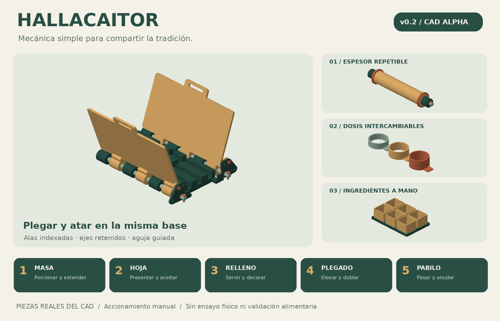
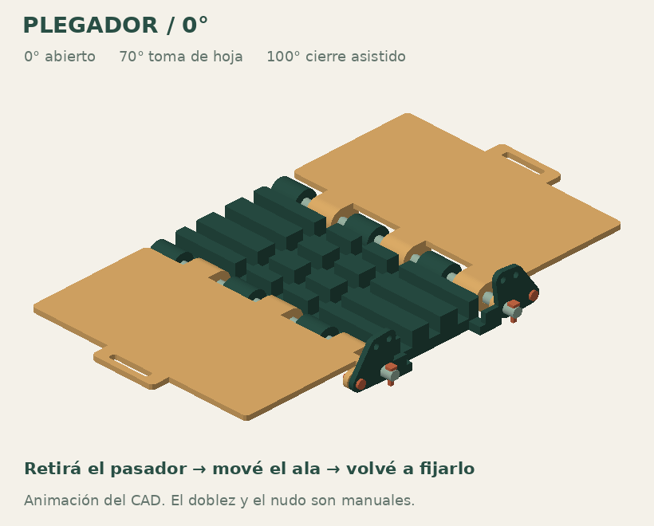
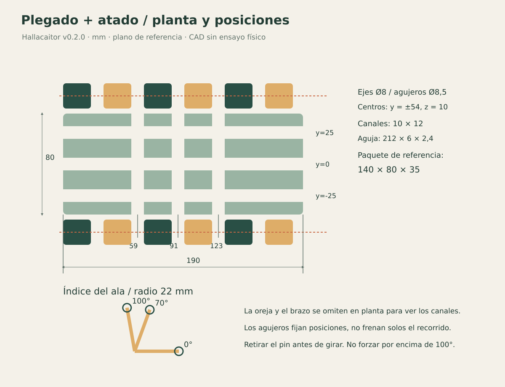
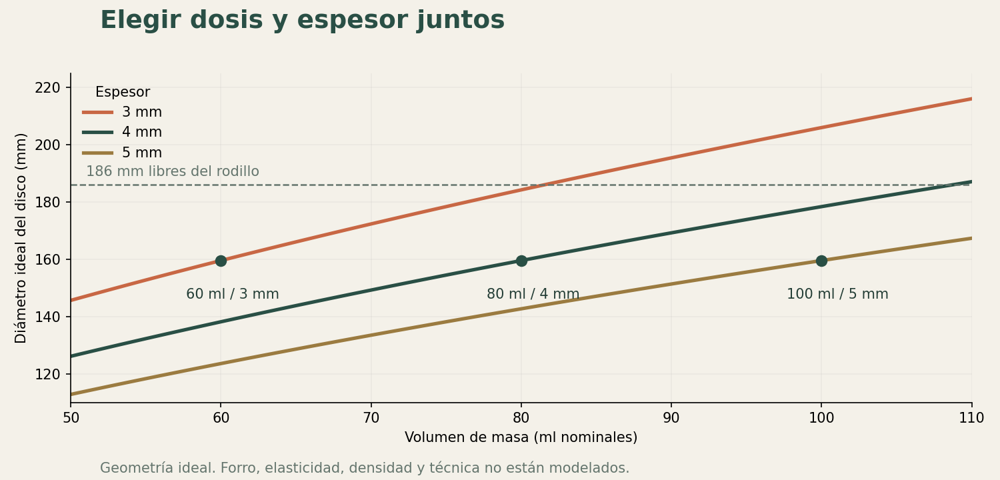

<div align="center">

# HALLACAITOR

### Menos improvisación en la mesa. Más hallacas.

**Estación manual, mecánica e imprimible en 3D para ayudar a armar hallacas venezolanas.**

[](LICENSE)
[](docs/testing.md)
[](https://github.com/ariel-rajmaliuk/hallacaitor/actions/workflows/validate.yml)

[Empezar](#empezá-por-el-kit-mínimo) · [STL](stl) · [Montaje](docs/assembly.md) · [Manual PDF](docs/manual/Hallacaitor_v02.pdf) · [English](docs/README.en.md)



</div>

Hallacaitor organiza el trabajo de **masa → hoja → relleno → plegado → pabilo**. Usa un rodillo con espesor controlado, porciones intercambiables, alas con posiciones fijables y una base que sirve tanto para plegar como para pasar la cuerda. Todo se mueve con las manos.

**Es un prototipo de CAD v0.2.0, todavía sin fabricar ni probar con comida.** Las comprobaciones digitales y sus límites están en [Validación](docs/testing.md). No se afirma que sea más rápido que una persona experta: eso se mide en las pruebas de uso.

## Qué hace

| Etapa | Ayuda incluida | Qué hacés vos |
|---|---|---|
| Masa | Aros de 60 / 80 / 100 ml, empujador y bandeja para amasar en bolsa | Mezclar la receta, amasar y llenar la medida |
| Hoja | Tabla de 360 × 360 mm, regla y plantilla A4 de 350 × 350 mm | Limpiar, ablandar, recortar, aceitar y presentar |
| Extendido | Rodillo con eje retenido y aros de 3 / 4 / 5 mm | Pasar el rodillo sobre una barrera alimentaria |
| Relleno | Medidas de 40 / 60 ml, seis recipientes y tapas desmontables | Servir guiso y adornos |
| Plegado | Alas fijables a 0°, 70° o 100°; pala para los extremos | Juntar la hoja, hacer el doblez central y poner el refuerzo/faja |
| Pabilo | Misma base, seis pasos inferiores, aguja roma y medidor | Pasar las vueltas, tensar y hacer el nudo |

**100% imprimible se refiere a las piezas permanentes:** no requiere motores, metal, rodamientos, pegamento ni resortes comprados. Comida, hojas, pabilo y barreras alimentarias son consumibles. No cocina, no corta y no anuda automáticamente.

## El módulo que conviene probar primero



Las alas se sostienen con pasadores de posición removibles. **Sacá ambos pasadores antes de moverlas y volvé a ponerlos en una posición indexada.** El eje largo se retiene con una cabeza y una chaveta transversal. Los pasos de cuerda coinciden con los huecos entre los nudillos de las bisagras.



## Empezá por el kit mínimo

1. Leé [Impresión y calibración](docs/printing.md) y [Contacto alimentario](docs/food-contact.md).
2. Imprimí los cupones `fit_coupon` y `key_coupon`. Probá los diámetros antes de imprimir ejes completos.
3. Imprimí base, dos alas, dos ejes, tres chavetas (una de repuesto), dos pasadores de posición, aguja y pala: **14 piezas contando los dos cupones**.
4. [Armá el plegador](docs/assembly.md) y probá primero con papel y un paquete simulado.
5. Comprobá el movimiento, la entrada de la aguja y la salida de las cuerdas. Recién después probá hojas reales, sin comida.
6. Si funciona, completá el [kit estándar](docs/bom.md) con rodillo, tabla y dosificadores.

Los [STL](stl) ya están exportados en **milímetros** y en orientación de impresión, salvo la tapa opcional que se invierte en el laminador. Cama de referencia: **220 × 220 × 250 mm**. El eje del rodillo se suministra en diagonal para que entre en la cama; no lo vuelvas a colocar paralelo al borde.

> Para ensayar con alimentos, la masa y el guiso deben quedar separados de las impresiones mediante barreras alimentarias adecuadas e íntegras. PETG no equivale a una pieza apta para contacto alimentario. [Criterio y fuentes](docs/food-contact.md).

## Elegí una porción compatible

| Masa nominal | Aro del rodillo | Disco ideal | Uso de partida |
|---|---:|---:|---|
| 60 ml | 3 mm | 160 mm | Masa fina |
| **80 ml** | **4 mm** | **160 mm** | **Configuración inicial** |
| 100 ml | 5 mm | 160 mm | Masa más gruesa |
| 100 ml | 4 mm | 178 mm | Disco más grande, ajustar relleno y hoja |

Son **volúmenes de cavidad**, no gramos. La densidad, el forro y la técnica cambian la cantidad real. No uses 100 ml con 3 mm: el disco ideal de 206 mm supera los 186 mm libres del rodillo.



## Archivos para fabricar y entender

| Carpeta / archivo | Contenido |
|---|---|
| [cad/hallacaitor.scad](cad/hallacaitor.scad) | Fuente paramétrica; vistas de conjuntos y piezas |
| [stl/](stl) | 32 tipos de pieza, sin archivos de relleno |
| [config/parts.json](config/parts.json) | Identificadores, cantidades por kit y orientación |
| [Lista de piezas](docs/bom.md) | Dimensiones, kits mínimo / estándar / completo y CSV |
| [Manual PDF](docs/manual/Hallacaitor_v02.pdf) | Guía ilustrada de montaje y uso |
| [Plantilla A4](docs/manual/Plantilla_hoja_350mm_A4.pdf) | Cuatro hojas para armar una guía de 350 mm, a escala 100% |
| [Planos SVG](docs/drawings) | Plegador, rodillo, despiece y recorrido del pabilo |
| [Diseño](docs/design.md) | Dimensiones, decisiones, cálculos y límites |
| [Referencias](docs/references.md) | Fuentes primarias y qué se tomó de cada una |
| [Ensayos](docs/testing.md) | Qué está comprobado y cómo registrar lo que falta |

## Modificar y verificar

Necesitás [OpenSCAD](https://openscad.org/downloads.html) y Python 3.10 o posterior. No hacen falta librerías de Python para exportar, calcular o comprobar las mallas.

```bash
# Exportar un kit, con dos procesos como máximo por defecto
python scripts/export.py --kit minimum

# Exportar todo
python scripts/export.py

# Auditar mallas, cama y enlaces; ejecutar pruebas de diseño
python scripts/validate.py
python -m unittest discover -s tests -v

# Comprobar muestras del recorrido y pasos de cuerda con booleanas CGAL
python scripts/check_motion.py

# Estimar diámetro de masa y longitud de pabilo
python scripts/calculator.py --volume 80 --thickness 4
```

Para redibujar imágenes, planos y PDFs: `pip install -r requirements-docs.txt`, luego `python scripts/illustrate.py` y `python scripts/manual.py`. [Instrucciones y controles](docs/development.md).

## Qué mejoró desde el primer boceto

**Plegado y atado integrados · posiciones de alas · ejes con chavetas · mangos retenidos · aros en ranuras · tres dosis compatibles · tabla plana con llaves · aguja con pasos despejados · planos y despiece · controles reproducibles.** Los detalles y la incompatibilidad de piezas están en [CHANGELOG](CHANGELOG.md).

## Participar

Se agradecen fotos de impresiones, mediciones de encaje y pruebas con hojas reales. [Cómo contribuir](CONTRIBUTING.md) · [Próximas mejoras](docs/roadmap.md) · [Planilla vacía de ensayos](examples/bench_log.csv).

Proyecto iniciado por [Ariel](https://github.com/ariel-rajmaliuk). Archivos del proyecto bajo [licencia MIT](LICENSE): podés usarlos, modificarlos y compartirlos, también comercialmente, conservando los avisos correspondientes. No se incluyen recetas, fotografías ni diseños de terceros. Las referencias enlazadas conservan sus propios derechos.
