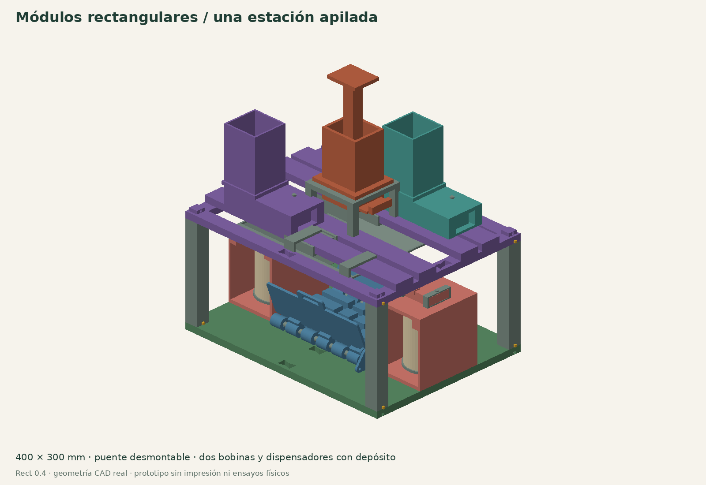
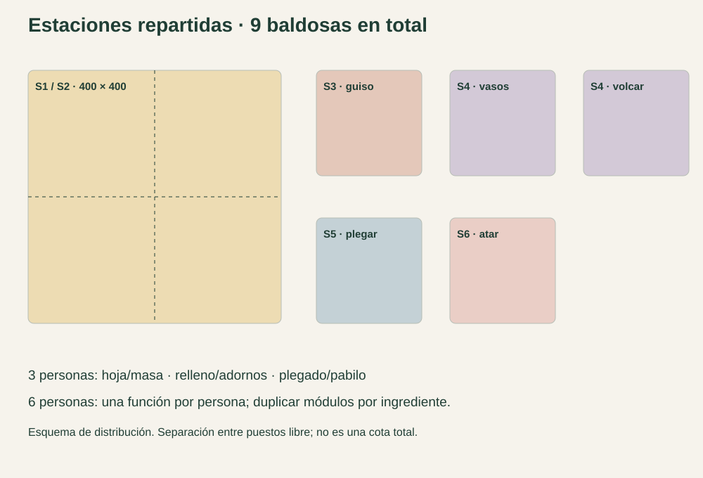
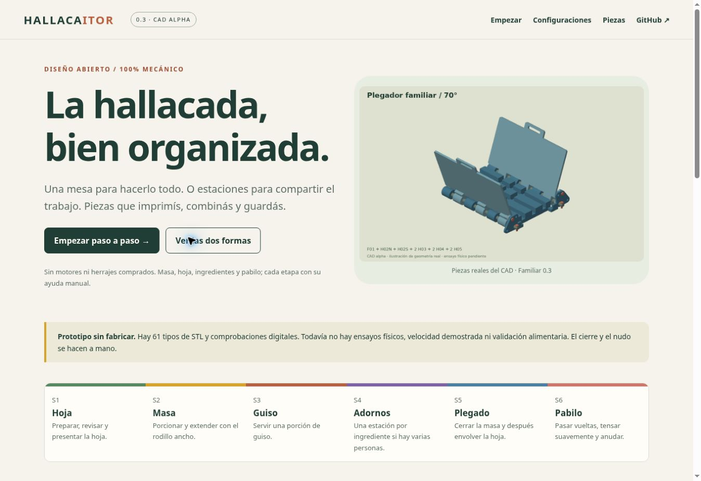

# HALLACAITOR

## Nuevo: Rect 0.4

[**Diseño rectangular: encastres, dispensadores y doble bobina**](designs/v04/README.md) · [**Manual web**](https://hallacaitor-manual.rajmaliuk.chatgpt.site)



Estaciones de 400 × 300 mm, apiladas con pasadores o repartidas por función. Incluye bobina activa y reserva, cartucho cubierto para hoja de afeitar y depósitos con corredera o émbolo. 43 tipos nuevos de STL y 42 muestras de intersección comprobadas. Prototipo CAD sin fabricar ni validar con alimentos, carga o cuchilla real.

---

## Familiar 0.3: versión anterior

**Una mesa para hacerlo todo. O estaciones para compartir la hallacada.**

Sistema manual, mecánico y abierto de útiles imprimibles en 3D para preparar y armar hallacas venezolanas.

[**Abrir el manual web →**](https://hallacaitor-manual.rajmaliuk.chatgpt.site) · [Empezar](docs/start.md) · [STL](stl) · [Montaje](docs/assembly.md) · [PDF Familiar](docs/manual/Hallacaitor_v03.pdf)


**Familiar 0.3 / CAD alpha, todavía sin fabricar ni probar con comida.** Hay modelos, cálculos y comprobaciones digitales; no hay velocidad, resistencia ni aptitud alimentaria demostradas. Las alas ayudan a levantar: el cierre de masa/hoja y el nudo son manuales.

## Las dos formas

| | Mesa única | Estaciones repartidas |
|---|---|---|
| Para empezar | Una o dos personas | Tres o seis personas; ampliar por ingrediente |
| Organización | 800 × 400 mm, ocho baldosas | Preparación 400 × 400 y cinco puestos separados |
| Plegado y pabilo | Comparten la base | Una base para cada tarea |
| Ingredientes | Medidas abiertas y seis recipientes | Lo mismo, más un volcador de porción precargada |
| Uniones | Dock200 común, 20 llaves de borde | Dock200 común, 8 llaves en preparación |
| Archivo de cantidades | `hub` | `team` |




S1 verde: hoja · S2 amarillo: masa · S3 terracota: guiso · S4 violeta: adornos · S5 azul: plegado · S6 coral: pabilo. Cada color lleva también número y nombre. Se pueden duplicar módulos para dedicar uno a cada ingrediente.

Los adaptadores se encastran **por gravedad**, sin retención al levantar. Las baldosas se unen en el plano. Los postes permiten **guardar dos niveles descargados**, retirando alas y piezas altas; no se trabaja con rodillo ni vasos abiertos en una torre. [Cotas y límites](docs/design.md).

## Qué se corrigió tras investigar

- **Proceso:** cerrar primero los bordes de masa sobre el guiso, después terminar costura de hoja, extremos, refuerzo y faja.
- **Tamaño:** el rodillo Compact de 186 mm útiles resultaba pequeño respecto de las recetas consultadas. Familiar tiene 266 mm útiles, dos camisas imprimibles y aros de 2,5 mm: 80/100 ml dan discos ideales de 202/226 mm. No son gramos.
- **Ingredientes:** guiso con trozos usa medidas abiertas. Aceitunas/pasas se cuentan previamente; el volcador entrega una porción cargada a mano. No se afirma que exista un dosificador universal.
- **Documentación:** manual web con 72 páginas, 61 fichas ilustradas, búsqueda por pieza/kit, calculadora, guías de uso, montaje, impresión, limpieza y problemas.

[Investigación y decisiones](docs/research.md) · [Fuentes primarias](docs/references.md) · [Compatibilidad Compact](docs/compact-design.md).

## Imprimir sin empezar por toda la máquina

1. Leer [impresión](docs/printing.md) y [contacto alimentario](docs/care.md).
2. Imprimir `fit_coupon` y `key_coupon`; probar con material y perfil finales.
3. Montar F01, las dos alas distintas, dos ejes, chavetas y pasadores. Probar papel y paquete simulado.
4. Probar una unión Dock y el rodillo partido. Comprobar giro, estabilidad y ausencia de escalón.
5. Con encastres resueltos, completar la [lista de fabricación](docs/bom.md) elegida.

Todo el hardware permanente se imprime: sin motores, tornillos, metal, rodamientos ni resortes comprados. Comida, hoja, pabilo y barreras alimentarias son consumibles. La preparación térmica, recorte y cocción quedan fuera. PETG no convierte la pieza en un objeto certificado para alimentos.

## Archivos

| Recurso | Contenido |
|---|---|
| [Manual web](https://hallacaitor-manual.rajmaliuk.chatgpt.site) | Inicio guiado, configuraciones, montaje y uso ilustrados |
| [Catálogo web](https://hallacaitor-manual.rajmaliuk.chatgpt.site/parts.html) | Imagen, cotas, orientación, cantidad y STL por pieza |
| [PDF Familiar](docs/manual/Hallacaitor_v03.pdf) | Compañero sin conexión del manual |
| [Plantilla A4 de hoja](docs/manual/Plantilla_hoja_350mm_A4.pdf) | Guía de 350 mm en cuatro hojas; imprimir al 100% |
| [cad/modular.scad](cad/modular.scad) | Dock, Familiar, eje partido y volcador |
| [cad/hallacaitor.scad](cad/hallacaitor.scad) | Compact y piezas reutilizadas |
| [config/parts.json](config/parts.json) | 61 tipos, cantidades, orientación y función |
| [config/stations.json](config/stations.json) | Colores, roles, interfaz y distribuciones |
| [BOM CSV](docs/bom-v3.csv) | Cantidades Familiar y medidas de impresión |
| [Informes](docs/validation) | Mallas y muestras booleanas de movimiento |
| [Ensayos](docs/testing.md) | Pruebas pendientes y registro sin datos inventados |

`minimum`/`standard` conservan los kits Compact de ensayo; `hub`/`team` son Familiar. `full` reúne máximos por tipo y opcionales: no es un montaje recomendado. El [manual Compact](docs/manual/Hallacaitor_v02.pdf) queda como archivo técnico; no mezclar sus ajustes de 4 mm con la configuración Familiar de 2,5 mm.

## Modificar y verificar

OpenSCAD 2021.01 o posterior y Python 3.10+. Los controles y la web usan solo la biblioteca estándar; gráficos/PDF usan [requirements-docs.txt](requirements-docs.txt).

```bash
python scripts/export.py --kit hub
python scripts/export.py --kit team
python scripts/export.py                 # todos los tipos
python -m unittest discover -s tests -v
python scripts/validate.py
python scripts/check_motion.py
python scripts/build_site.py             # build/site; comprueba enlaces locales
```

Gráficos y PDF: `python scripts/illustrate_v3.py`, `python scripts/manual_v3.py`. El manual Compact y plantilla se regeneran con `python scripts/manual.py`. No se entrega G-code.

## Publicar el manual



La web es estática y no depende de servicios para consultar instrucciones. Su contenido está en [web/](web), el constructor en [scripts/build_site.py](scripts/build_site.py) y el flujo [Pages](.github/workflows/pages.yml) publica el mismo sitio. [Instrucciones de alojamiento y réplica](docs/website.md).

La instancia pública también usa [Sites](https://hallacaitor-manual.rajmaliuk.chatgpt.site). Para activar la dirección de GitHub Pages hace falta una vez **Settings → Pages → Source: GitHub Actions**, y volver a ejecutar `Build and publish manual`; el conector usado para subir archivos no tiene administración de Pages. El flujo siempre construye y verifica el manual aunque Pages todavía no esté activo.

## Contribuir

[Cómo contribuir](CONTRIBUTING.md) · [Plan de ensayos](docs/testing.md) · [Registro vacío](examples/bench_log.csv) · [Problemas](https://github.com/ariel-rajmaliuk/hallacaitor/issues).

Proyecto iniciado por [Ariel](https://github.com/ariel-rajmaliuk). Licencia [MIT](LICENSE): se puede usar, modificar, compartir y comercializar conservando los avisos. Referencias externas conservan sus derechos; no se incluyen recetas, fotos ni CAD de terceros.
