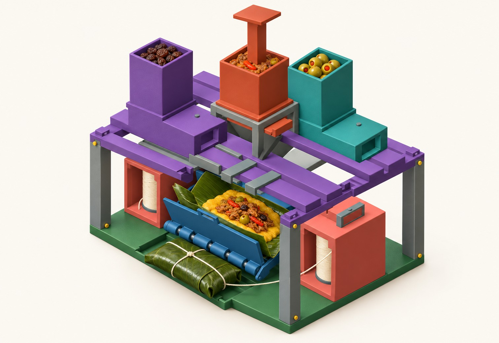
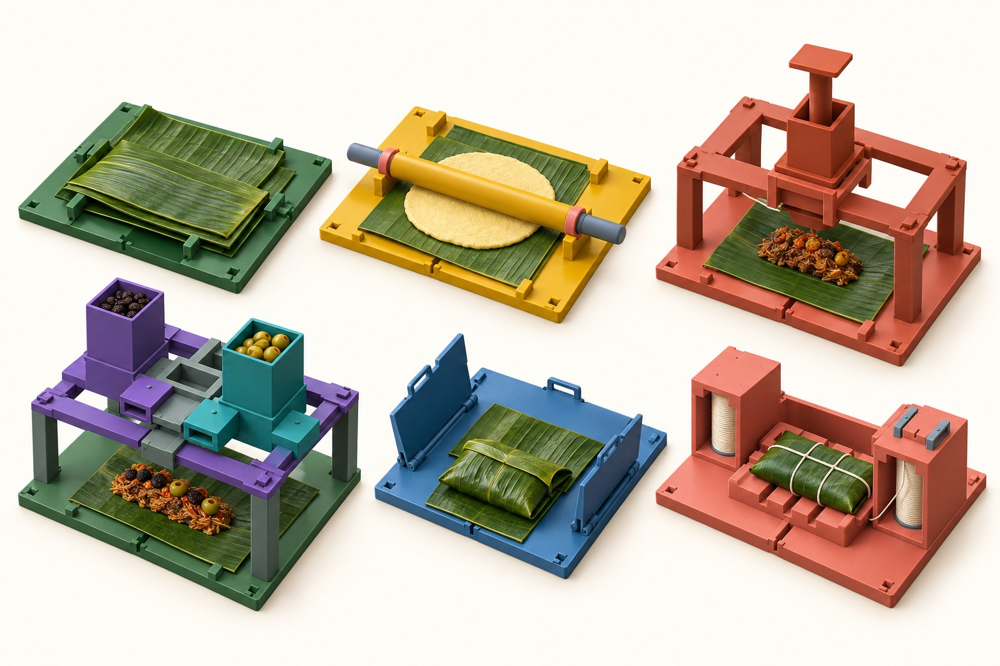
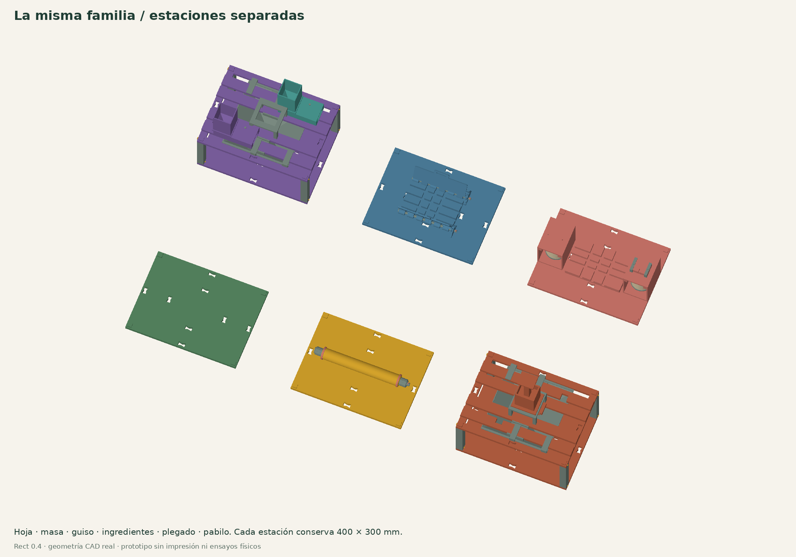
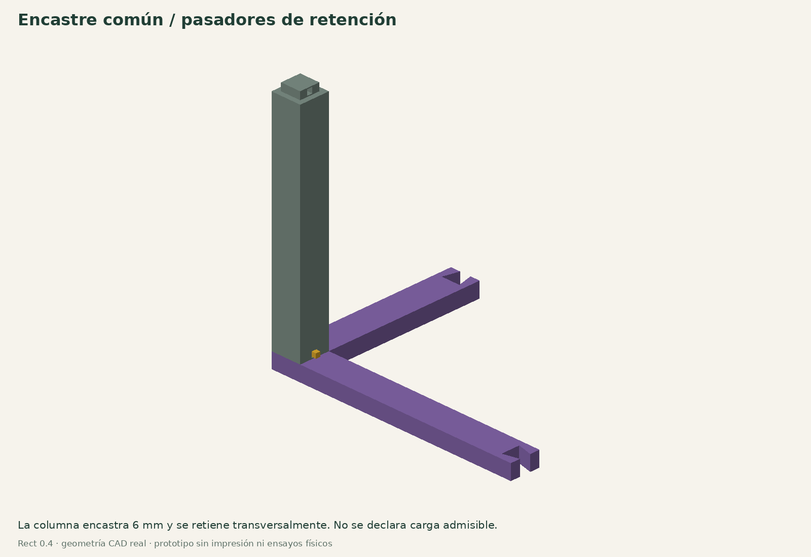
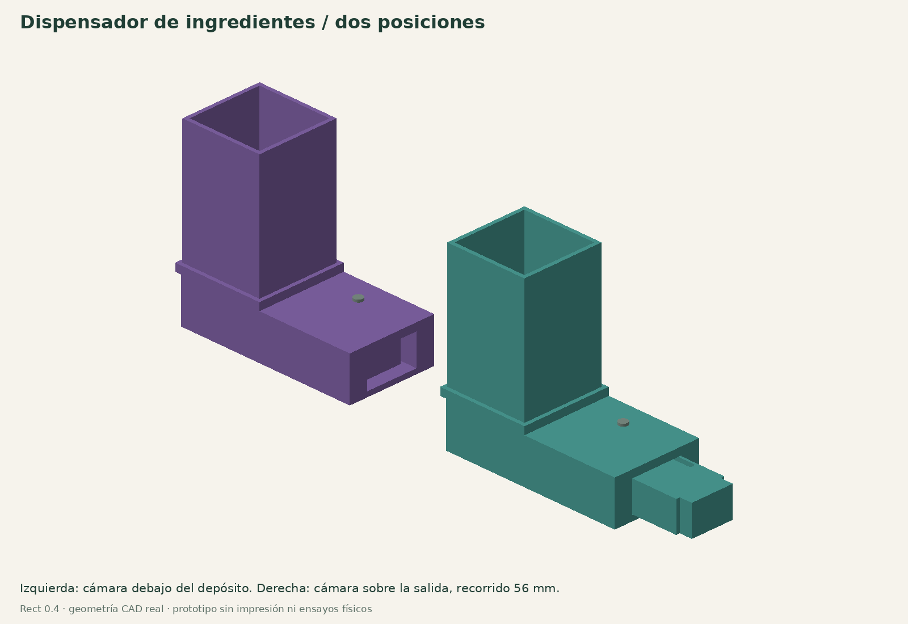
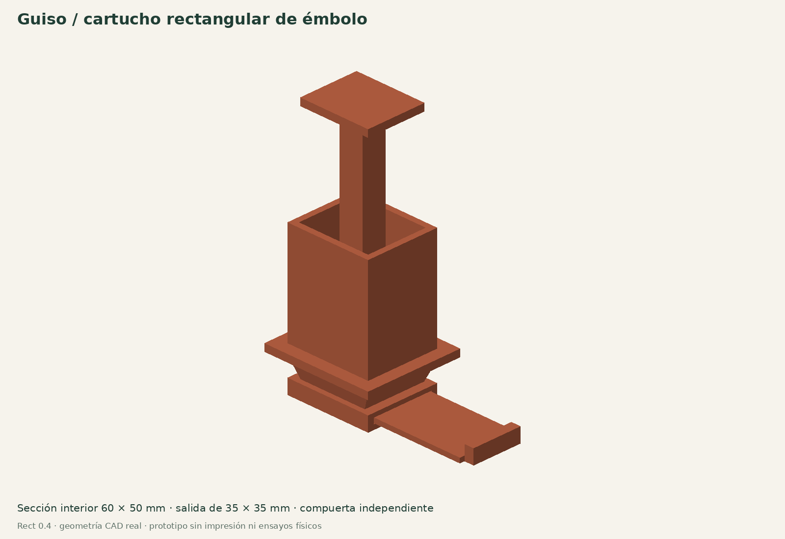
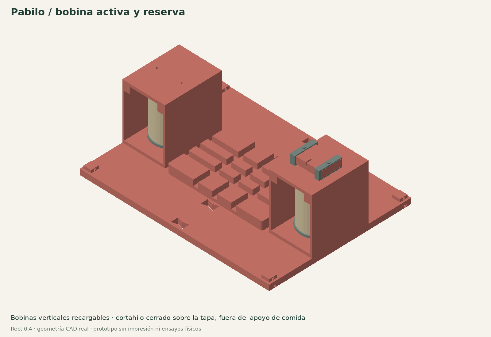
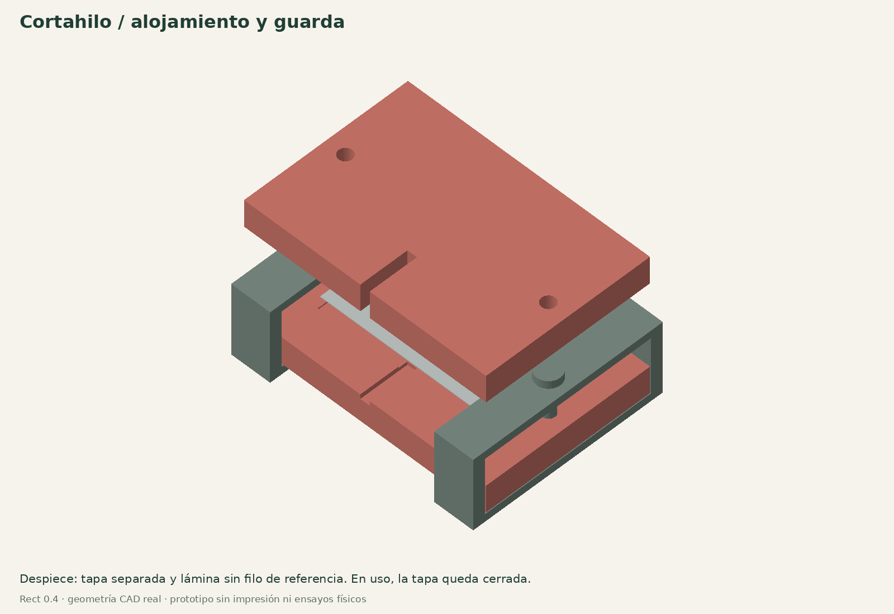

# Hallacaitor Rect 0.4

**Estaciones rectangulares de 400 × 300 mm, encastrables entre sí o repartidas entre personas.**

[Guía web ilustrada](https://hallacaitor-manual.rajmaliuk.chatgpt.site/rect/index.html) · [Kit completo ZIP](https://hallacaitor-manual.rajmaliuk.chatgpt.site/rect/Hallacaitor_Rect_v04.zip) · [CAD paramétrico](../../cad/rectangular.scad) · [STL nuevos](stl) · [Piezas y cantidades](parts.json) · [Comprobaciones digitales](validation)


Esta revisión cambia la arquitectura física de Familiar 0.3. Es un **prototipo de CAD, sin fabricar ni probar con comida, carga o una cuchilla real**. Se mantiene por separado para distinguir sus comprobaciones de las de 0.3. Los encastres Rect no son compatibles con Dock200 ni con bloques LEGO comerciales.

## La hallaca en el sistema



Ilustración conceptual generada con IA a partir del CAD. Muestra alimento y varios estados de trabajo juntos para explicar el uso; puede simplificar detalles de hardware. No es una fotografía, un plano de fabricación ni prueba de funcionamiento. Las vistas CAD y los STL son la referencia geométrica.



## Qué cambió

| Pedido | Implementación Rect 0.4 |
|---|---|
| Espacio rectangular para la hallaca | Marco común de 400 × 300, dividido en cuatro piezas de 200 × 150 |
| Apilar o separar | Esquinas con espiga de 16 × 16 × 6, alojamiento de 16,6 × 16,6 y pasador transversal |
| Un color por función | Hoja verde, masa amarilla, guiso terracota, ingredientes violeta/turquesa, plegado azul, pabilo coral |
| Rollo de hilo | Dos portabobinas verticales rectangulares: activa y reserva, con tapas desmontables |
| Cortar hilo | Cartucho para hoja de afeitar, tapa cerrada, collares y pasadores; entrada estrecha de pabilo |
| Dispensadores | Depósito y corredera para ingredientes sueltos, cartucho de émbolo para guiso y cassette de porciones de tiras |
| Hallaca dentro del plegador | Alas nuevas cortas que entran en el marco con el plegador abierto |

El cuerpo nominal ocupa 400 × 300 mm. Los pasadores y mandos necesitan espacio alrededor; el recorrido de los dispensadores también debe quedar libre. El conjunto de dos niveles tiene una envolvente vertical aproximada de 443 mm con el émbolo levantado.

## Dos configuraciones

### A. Un puesto con puente superior

El marco inferior recibe la bandeja de preparación o el plegador corto. El puente superior aloja los depósitos y el embudo común, centrado sobre el área de trabajo. Los portabobinas ocupan los laterales durante plegado/atado. Para extender con el rodillo ancho se retiran los portabobinas y el plegador: sus cassettes se cambian por tanda, sin modificar el encastre del marco.

Las correderas, el émbolo, el plegado y el nudo se accionan con las manos. Se propone trabajar por tandas para no cambiar cassettes en cada hallaca. La rapidez y el acceso real de las manos todavía se deben medir.

El apilado previsto para el primer ensayo tiene **dos niveles**, con columnas y pasadores. No se declara estabilidad ni carga admisible. No encadenar más niveles cargados antes de hacer pruebas de vuelco, flexión y retención.

### B. Un puesto por función



Cada estación conserva la huella rectangular. Hoja y masa pueden usar bases planas; guiso e ingredientes usan el puente; plegado usa el inserto azul; pabilo usa el inserto de canales con sus bobinas. Se trasladan las hojas o paquetes manualmente. Para dedicar una estación a cada adorno se duplica su depósito/corredera y se la identifica por ingrediente y color.

## Encastre y estructura

- Cada cuarto de marco tiene una espiga superior y un alojamiento inferior en la esquina exterior.
- Cuatro columnas separan los marcos. La columna mide 180 mm, con 174 mm de cuerpo y 6 de espiga superior.
- La separación entre marcos equivalentes es 186 mm. El hueco nominal entre la cara superior inferior y la parte inferior del marco superior es de 174 mm.
- Un pasador transversal atraviesa cada conexión. Para desmontar, se retira el pasador antes de levantar.
- Las traviesas superiores se unen con cunas inferiores abiertas. Esas cunas apoyan por gravedad y no son puntos de izado.
- El embudo se apoya con cuatro ganchos, uno por cuadrante. Las juntas entre los cuatro cuartos no están selladas ni validadas para producto húmedo; probar alineación y deformación en seco. Se retira para limpiar y para comprobar el acceso al paquete.



## Dispensadores reales de corredera



El depósito rectangular alimenta una cámara móvil. En la posición inicial, la cámara está bajo la carga y el fondo de la carcasa la cierra. Al tirar 56 mm, la cámara queda sobre la descarga y el cuerpo de la corredera tapa la alimentación. Al volver, se recarga.

El pasador guía recorre una ranura cerrada y limita el movimiento. El retorno es manual. Las piezas se separan para inspección y limpieza.

| Cámara | Volumen geométrico | Uso a ensayar |
|---|---:|---|
| 22 × 22 × 24 mm | 11,616 ml | Porciones mayores o ingredientes grandes que pasen por la garganta |
| 14 × 14 × 24 mm | 4,704 ml | Porciones pequeñas de ingredientes sueltos |

No se declara conteo automático de aceitunas. Tamaño, humedad, forma y adherencia cambian el llenado y pueden causar puentes o pellizcos en la compuerta. Probar primero simulantes y después el ingrediente real bajo un procedimiento de contacto alimentario validado. Un ingrediente pegajoso puede requerir otra geometría de garganta.

## Cartucho rectangular de guiso



Sección interior de 60 × 50 mm, compuerta independiente y salida de 35 × 35 mm. La mano abre la compuerta, desplaza el émbolo y vuelve a cerrar. Un recorrido de 20 mm desplaza 60 ml geométricos; 13,33 mm desplazan unos 40 ml. Los bloques suministrados sirven como **calibres de recorrido**, no como un mecanismo que reinicia automáticamente la dosis.

El volumen real puede variar por aire, presión, trozos y arrastre. No se verificaron fuerza, goteo, atasco ni repetibilidad. El cartucho tampoco sustituye una dosificadora industrial. Se investigaron equipos con pasos amplios para productos con trozos; no se copian sus diseños ni rendimientos.

## Pimiento y otras tiras

El cassette de cuatro bandejitas permite preparar una porción por bandeja, retirarla y colocarla sobre la masa. Es una alternativa para tiras que se enredan o no fluyen por gravedad. Se precarga a mano y no se presenta como un contador automático.

## Pabilo: bobina activa y reserva



Cada caja tiene un eje vertical, una bobina partida recargable y una tapa. La apertura frontal permite observar el hilo restante. Hay dos cajas: una suministra hilo y la otra conserva una bobina lista para el cambio manual.

- Bobina impresa: pestañas Ø76 mm, núcleo Ø26, 88 mm de ancho útil.
- Envolvente de bobinado prevista: hasta Ø72 mm.
- Para bobina comercial: comprobar diámetro máximo, ancho y núcleo antes de usar el adaptador inicial Ø25. No se afirma compatibilidad con cualquier ovillo.
- La capacidad en metros depende del diámetro del pabilo y del bobinado. No hay una cantidad de hallacas medida.
- La tapa evita que la bobina salga del eje durante el uso normal previsto. La retención y fricción necesitan prueba física.

## Cartucho de corte de hilo



El alojamiento parte de una hoja de afeitar de doble filo nominal de **43 × 22 × 0,1 mm**. La cavidad es de 43,6 × 22,6 mm y debe comprobarse con la hoja concreta. Hay variaciones entre fabricantes.

La base, la tapa, los dos collares y los pasadores forman la guarda. En funcionamiento la hoja permanece cubierta y el pabilo entra por una ranura de 2,4 mm, con el filo retirado unos 10 mm del borde frontal. El filo opuesto queda encerrado. El conjunto se instala encima del portabobina derecho, separado del plano donde se apoya la comida.

1. Probar primero el montaje con `blade_dummy`, una lámina plástica sin filo.
2. Comprobar el cierre de tapa, collares y pasadores antes de considerar una hoja real.
3. La hoja real se instala/desinstala con el cartucho retirado del puesto, sin alimento alrededor.
4. Operar siempre con tapa y collares colocados. La geometría de guarda todavía no se probó con hilo ni se certificó como herramienta segura.

**La estructura y la guarda se imprimen. La hoja de afeitar es un consumible comprado**, incorporado por pedido del usuario. No se afirma que una cuchilla funcional pueda imprimirse en FDM.

## Hoja, masa y espacio útil

El marco puede presentar una hoja de hasta unos 350 × 300 mm, como hipótesis de prueba. Si la receta requiere 350 × 350 mm habrá voladizo y habrá que comprobar que no se atrape al cambiar de cassette. No se reduce la hoja obligatoriamente para hacerla coincidir con el marco.

La porción de masa sigue siendo una elección de receta. El rodillo Familiar conservado tiene 266 mm útiles. El plegador corto ocupa aproximadamente 298 mm en la dirección de apertura; las nuevas alas conservan sus ejes e índices, pero no se mezclan con las alas largas del montaje anterior.

## Fabricación inicial

Todos los STL nuevos están en `stl/`, en milímetros y orientados para una cama nominal de 220 × 220 × 250 mm. La lista JSON indica cantidades del conjunto apilado de referencia y las piezas reutilizadas del proyecto 0.3.

1. Probar primero un cuarto de marco, una columna y dos pasadores.
2. Seguir con una carcasa, corredera, tapa y pasador guía. Probar vacío, sin comida.
3. Probar las dos mitades de bobina y su caja, eje y tapa.
4. Probar el cortahilo con lámina plástica sin filo.
5. Imprimir una base y probar el plegador con papel, después hojas sin comida.
6. Completar el puente y sus depósitos después de resolver encastres y estabilidad.

Perfil inicial propuesto: boquilla 0,4, capa 0,2 mm, 4 perímetros en cajas y 5–6 en columnas/pasadores/guías. PETG es un candidato estructural, sin validación alimentaria. No se entregan tiempos ni gramos sin laminado real. Los alojamientos, guías y puentes requieren inspección de soportes y primera capa en el laminador.

Los dispensadores con piezas móviles y producto húmedo necesitan un sistema higiénico de contacto alimentario que permita funcionar sin forros que se enganchen en las guías. Eso no está resuelto ni validado por el CAD. Hasta resolverlo, usar simulantes no destinados a consumo. No se considera apta una pieza solo por estar impresa en PETG.

## Comprobación reproducible

```bash
python scripts/rect_v04.py
```

La primera orden exporta los 43 tipos y comprueba mallas, envolventes y muestras de intersección. Las vistas de conjunto y de cada pieza ya están incluidas en `assets/`. El ZIP incluye las piezas reutilizadas y el comprobador de mallas. Los JSON detallan el alcance y la fuente exacta. No se hicieron ensayos físicos ni análisis de carga, elasticidad, higiene, corte o rendimiento.

## Fuentes de esta revisión

- [Baili, medidas de hoja de doble filo](https://www.bailishaver.com/product/platinum-coated-smooth-double-edge-razor-blades-for-shaving/): referencia dimensional del consumible, sin copiar geometría industrial.
- [ROVEMA, dosificación volumétrica](https://www.rovema.com/en/packaging-machines/dosing-systems/vdd/): productos sueltos y volumen; no justifica dosificar cualquier ingrediente de igual forma.
- [Unifiller Pro 2000i](https://www.unifiller.com/food-machine/pro-2000i): importancia de pasos amplios para productos con trozos. Sus cargas, materiales, velocidades y resultados no se atribuyen a este prototipo.

Archivos propios bajo MIT. Referencias externas conservan sus derechos.

## Cantidades del conjunto apilado de referencia

Las piezas de cada estación se imprimen con su color. Los marcos usan el color de la función o nivel; pasadores y ejes pueden ser grises. Los colores de la tabla orientan la organización, no alteran geometría.

| ID | Pieza | Unidades | Función / color |
|---|---|---:|---|
| R01 | [Cuarto de base rectangular](stl/rect_tile.stl) | 4 | marco común, imprimir con color de estación |
| R02 | [Cuarto de marco abierto](stl/rect_frame.stl) | 4 | marco común, imprimir con color de estación |
| R03 | [Llave de unión de marco](stl/rect_key.stl) | 12 | marco común, imprimir con color de estación |
| R04 | [Columna de encastre de 180 mm](stl/tower_post.stl) | 4 | común |
| R05 | [Pasador transversal de retención](stl/tower_pin.stl) | 8 | común |
| R06 | [Ala corta norte](stl/short_wing_north.stl) | 1 | plegado |
| R07 | [Ala corta sur](stl/short_wing_south.stl) | 1 | plegado |
| R08 | [Cuerpo del dosificador por corredera](stl/dry_housing.stl) | 2 | ingrediente por corredera |
| R09 | [Tapa de guía del dosificador](stl/dry_lid.stl) | 2 | ingrediente por corredera |
| R10 | [Corredera de cámara 22 × 22 × 24](stl/dry_shuttle.stl) | 1 | ingrediente por corredera |
| R11 | [Corredera de cámara 14 × 14 × 24](stl/dry_shuttle_small.stl) | 1 | ingrediente por corredera |
| R12 | [Depósito rectangular desmontable](stl/dry_hopper.stl) | 2 | ingrediente por corredera |
| R13 | [Tapa antipolvo del depósito](stl/dry_lid_cap.stl) | 2 | ingrediente por corredera |
| R14 | [Pasador guía que limita el recorrido](stl/dry_guide_pin.stl) | 2 | ingrediente por corredera |
| R15 | [Cartucho rectangular para guiso](stl/guiso_body.stl) | 1 | guiso |
| R16 | [Compuerta manual de cierre](stl/guiso_gate.stl) | 1 | guiso |
| R17 | [Émbolo rectangular](stl/guiso_piston.stl) | 1 | guiso |
| R18 | [Calibre de recorrido de 20 mm](stl/piston_stop_20.stl) | 1 | guiso |
| R19 | [Calibre de recorrido de 13,33 mm](stl/piston_stop_13.stl) | 1 | guiso |
| R20 | [Cassette de cuatro porciones de tiras](stl/strip_magazine.stl) | 0 | tiras precargadas |
| R21 | [Bandejita extraíble de una porción de tiras](stl/strip_drawer.stl) | 0 | tiras precargadas |
| R22 | [Tapa del cassette de tiras](stl/strip_lid.stl) | 0 | tiras precargadas |
| R23 | [Caja rectangular de bobina vertical](stl/spool_box.stl) | 2 | pabilo |
| R24 | [Media bobina con acople macho](stl/spool_left.stl) | 2 | pabilo |
| R25 | [Media bobina con acople hembra](stl/spool_right.stl) | 2 | pabilo |
| R26 | [Adaptador de núcleo comercial Ø25](stl/spool_adapter.stl) | 0 | pabilo |
| R27 | [Eje vertical de bobina](stl/spool_axle.stl) | 2 | pabilo |
| R28 | [Tapa desmontable de portabobina](stl/spool_cover.stl) | 2 | pabilo |
| R29 | [Arandela de apoyo de bobina](stl/spool_washer.stl) | 2 | pabilo |
| R30 | [Base con alojamiento para hoja de afeitar](stl/cutter_base.stl) | 1 | pabilo |
| R31 | [Guarda superior del cortahilo](stl/cutter_cover.stl) | 1 | pabilo |
| R32 | [Collar exterior de cierre de guarda](stl/cutter_clamp.stl) | 2 | pabilo |
| R33 | [Pasador corto de la guarda](stl/cutter_pin.stl) | 0 | pabilo |
| R34 | [Pasador largo de montaje sobre portabobina](stl/cutter_mount_pin.stl) | 2 | pabilo |
| R35 | [Pedestal del cortahilo](stl/cutter_pedestal.stl) | 1 | pabilo |
| R36 | [Lámina plástica sin filo para probar montaje](stl/blade_dummy.stl) | 1 | común |
| R37 | [Media traviesa del puente](stl/bridge_half.stl) | 6 | común |
| R38 | [Cuna inferior de unión de traviesas](stl/bridge_joiner.stl) | 4 | común |
| R39 | [Traviesa delantera con paso de descarga](stl/bridge_dry_front.stl) | 1 | común |
| R40 | [Traviesa trasera con paso de descarga](stl/bridge_dry_back.stl) | 1 | común |
| R41 | [Soporte elevado del cartucho de guiso](stl/guiso_mount.stl) | 1 | guiso |
| R42 | [Cuarto de embudo receptor rectangular](stl/funnel_quarter.stl) | 4 | común |
| R43 | [Gancho de apoyo del embudo](stl/funnel_hanger.stl) | 4 | común |

### Piezas reutilizadas de Familiar 0.3

- [fold_base_family](../../stl/fold_base_family.stl) × 1
- [hinge_axle](../../stl/hinge_axle.stl) × 2
- [lock_key](../../stl/lock_key.stl) × 4
- [index_pin](../../stl/index_pin.stl) × 2
- [wide_roller_left](../../stl/wide_roller_left.stl) × 1
- [wide_roller_right](../../stl/wide_roller_right.stl) × 1
- [wide_axle_left](../../stl/wide_axle_left.stl) × 1
- [wide_axle_right](../../stl/wide_axle_right.stl) × 1
- [axle_joint_pin](../../stl/axle_joint_pin.stl) × 1
- [roller_grip](../../stl/roller_grip.stl) × 2
- [roller_washer](../../stl/roller_washer.stl) × 1
- [ring_2_5mm](../../stl/ring_2_5mm.stl) × 2
- [dose_80ml](../../stl/dose_80ml.stl) × 1
- [dose_100ml](../../stl/dose_100ml.stl) × 1
- [dose_plunger](../../stl/dose_plunger.stl) × 1
- [thread_needle](../../stl/thread_needle.stl) × 1
- [end_paddle](../../stl/end_paddle.stl) × 1

- [tie_base_family](../../stl/tie_base_family.stl) × 1 (inserto de la estación de pabilo separada)
