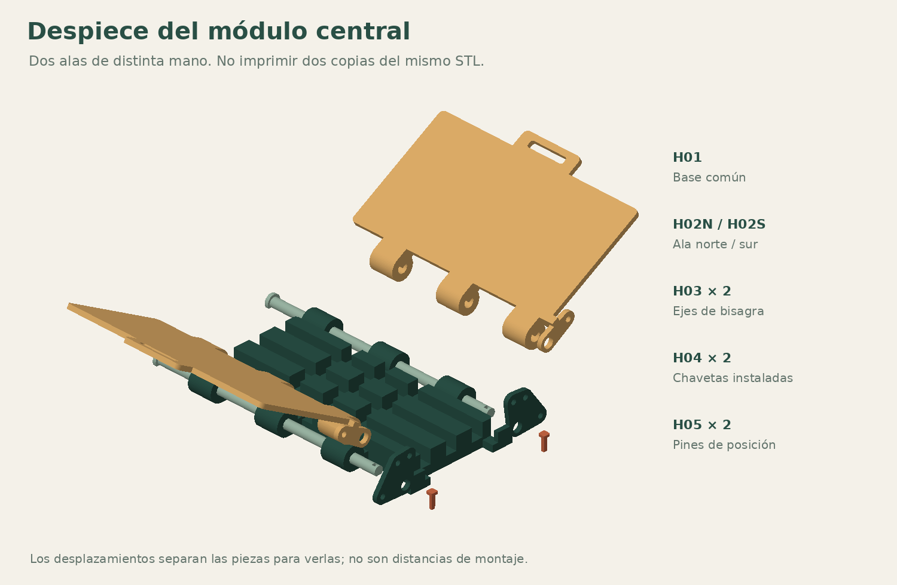
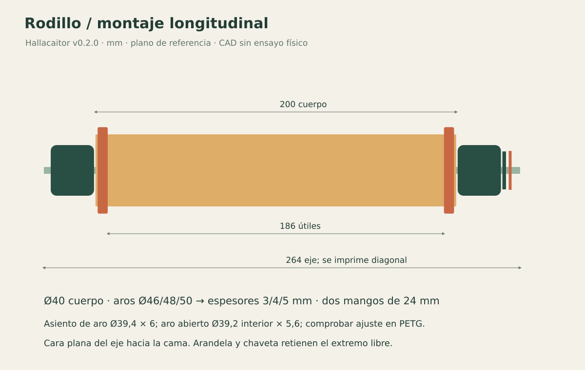

# Montaje

[Inicio](../README.md) · [Lista de piezas](bom.md) · [Impresión](printing.md)

## 1. Calibrar antes de ensamblar

Imprimir C01 y C02 primero. El cupón de diámetros tiene columnas con **0,3 / 0,4 / 0,5 / 0,6 mm de holgura diametral**. Filas: Ø4, Ø8, Ø12. Recortar una sección corta del eje correspondiente en el laminador para probar; no fabricar los ejes largos antes de elegir el ajuste. El cupón de chavetas permite probar huecos rectangulares de 2,8×3,4 / 2,9×3,5 / 3,0×3,6 mm. Insertar una chaveta desde su extremo fino.

El valor fuente es `clearance=0.5`. Elegir el agujero que gire sin atascar y sin juego excesivo; no golpear ni forzar. Un cambio de impresora, material u orientación exige revisar otra vez los encajes.

## 2. Plegador y base de atado

1. Apoyar H01 en la mesa, con los canales hacia arriba y las orejas de índice a la derecha.
2. Colocar H02N al norte y H02S al sur, mirando el plano. La cara amplia lisa queda arriba; los barriles se alternan con los de la base. Las alas son piezas de distinta mano: no imprimir dos copias del mismo archivo.
3. **No mover el brazo del ala al lado izquierdo:** el brazo con agujero de posición debe quedar junto a la oreja fija, en x≈191–200 mm, a la derecha de la base.
4. Introducir H03 por la izquierda. La cabeza queda fuera del nudillo inicial; la punta atraviesa el brazo del ala y la oreja fija.
5. Introducir una H04 en el agujero transversal de la punta del eje. La cabeza de la chaveta queda arriba. Es una retención removible: revisar que no camine hacia afuera durante las pruebas.
6. Repetir del otro lado.
7. Alinear cada ala con uno de los tres agujeros y colocar H05 desde la cara exterior derecha. El pasador atraviesa la oreja fija y el brazo móvil. Debe entrar sin flexionar el brazo.
8. Para cambiar de posición, sostener el asa, quitar H05, mover despacio y volverlo a insertar. **No girar con el pasador colocado.**

A 0° las alas quedan abiertas. A 70° ayudan a tomar la hoja. A 100° acercan sus bordes, pero la costura sigue siendo manual. No exceder el ángulo documentado. Los dedos se mantienen en asas y bordes libres, lejos de bisagras y chavetas.

### Posiciones de referencia

| Elemento | Coordenada de montaje (mm) |
|---|---|
| Ejes largos | x=-3..209; y=±54; z=10 |
| Agujero del brazo móvil | radio 22 desde el eje |
| Centro de paquete de referencia | x=91; y=0 |
| Líneas de atado | x=59/91/123 y y=-25/0/25 |

## 3. Rodillo con mangos retenidos

El eje R02 ya está en diagonal en el STL para imprimirlo. En montaje queda recto dentro del cuerpo.

1. Introducir un R03 desde la punta larga hasta acercarlo a la cabeza del eje.
2. Montar dos aros iguales R05 en las ranuras de R01. Abrir suavemente el aro por su corte; no intentar pasarlo a presión a través de todo el cilindro. Si se agrieta, revisar material y ajuste.
3. Pasar R01 por el eje. El aro no debe quedar fuera de su ranura.
4. Añadir el segundo R03, luego R04 y por último H04 en el agujero transversal del eje.
5. Girar el cuerpo sujetando los dos mangos. Debe rotar libremente; los mangos no deben poder salirse axialmente mientras la chaveta está colocada.

La arandela no es un ajuste a presión: el pequeño juego axial es deliberado. Si se traba, no rebajar el eje sin medir; revisar rebabas y el diámetro elegido en el cupón.

## 4. Tabla plana

Colocar cuatro B01 en cuadrícula 2×2, directamente sobre la mesa. Introducir ocho B02 por arriba en las aberturas con forma de mariposa de las juntas interiores: cuatro sobre cada eje. La llave queda **0,2 mm más baja** que la cara de trabajo. Siempre hay una hoja o barrera sobre las juntas.

Las llaves evitan separación en el plano, pero **no bloquean el levantamiento vertical**. No transportar el tablero por una sola baldosa: desarmarlo o sostenerlo completo desde abajo. Las medias aberturas del perímetro quedan sin llave.

## 5. Organizador y accesorios

Colocar seis O02 dentro de O01. Para usar O03, invertir cada tapa opcional con la cara cerrada hacia arriba durante el uso; encaja sobre el borde exterior del recipiente. **No es hermética ni sirve para conservación**. Forrar el recipiente cubriendo también su borde antes de cargar ingredientes.

D02 sirve para los tres aros de masa. Su disco tiene Ø59 mm para un aro de Ø60: dejar el juego para la barrera, no agregar cinta ni forzar. El espacio puede ser insuficiente para un forro grueso o plegado: comprobarlo antes de servir comida.

Todos los módulos se desmontan sin pegamento. Si un eje, aro, chaveta o borde se agrieta, suspender la prueba de ese módulo y reemplazar la pieza.
