# Montaje, conjunto por conjunto

[Manual web](https://hallacaitor-manual.rajmaliuk.chatgpt.site/assembly.html) · [Inicio](../README.md)

Las imágenes son renders de los STL entregados. Las holguras son valores iniciales: el CAD no simula deformación, rozamiento ni estabilidad con carga. Desbarbar fuera de la zona de comida y lavar según el procedimiento documentado.

## Dock · 1 / Preparar las baldosas

Retirar soportes sin redondear tetones ni abrir alojamientos a ojo. Colocar K01 con patas abajo y alojamientos arriba. Confirmar cuatro apoyos firmes. No poner sobre una mesa combada. Antes de imprimir ocho, probar una baldosa, una tapa y dos llaves.

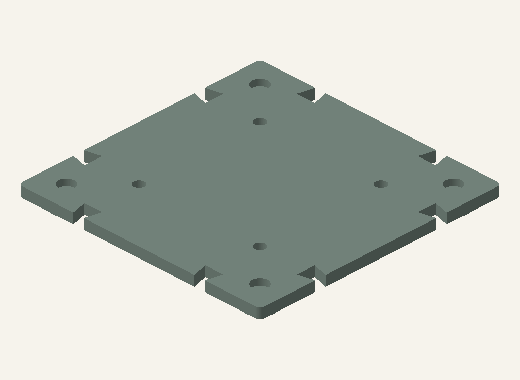

## Dock · 2 / Unir bordes

Presentar baldosas al mismo nivel e introducir dos K02 por borde compartido. La llave alinea en el plano; no es una manija ni un cierre contra levantamiento. En la mesa única, unir los diez bordes internos con 20 llaves. En la mesa de preparación del equipo, cuatro bordes internos llevan ocho llaves.

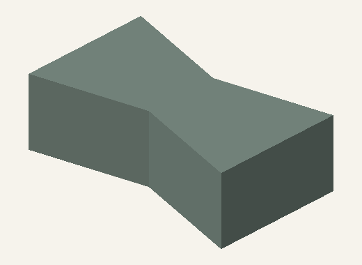

## Dock · 3 / Montar adaptadores

Alinear los cuatro tetones Ø8 con alojamientos Ø8,6 en paso de 100 mm. Bajar verticalmente sin golpes. La tapa asienta sobre la cara superior de K01, no sobre el fondo de los alojamientos. Colocar una etiqueta S en el rebaje. Sujetar ambas piezas al moverlas: la unión es por gravedad.

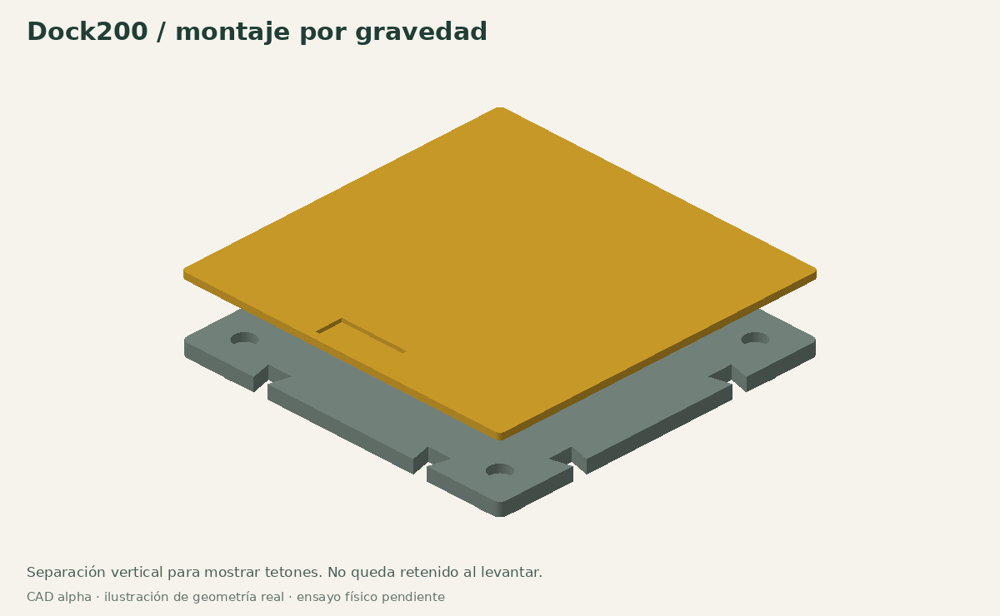

## Rodillo · 1 / Unir el eje

W03 y W04 tienen planos complementarios. Solapar 24 mm: el extremo del eje derecho comienza en x=160 del izquierdo y los agujeros coinciden en x=172. Insertar W05 Ø4 hasta dejarlo a ras del eje. Largo resultante: 344 mm. No usar si el eje unido flexiona o se abre en el ensayo con una carga simulada.

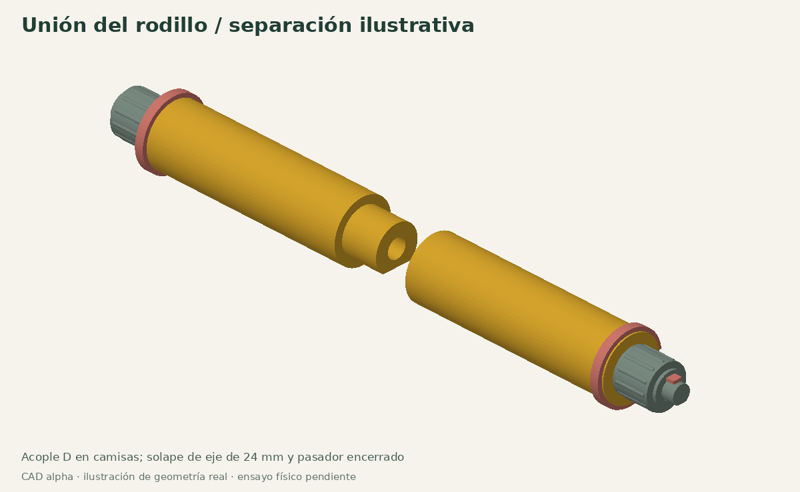

## Rodillo · 2 / Cerrar las camisas

Deslizar W01 y W02 sobre el eje. Acoplar el perfil D macho con el hembra hasta juntar las caras; el pasador queda encerrado bajo el tambor. El cuerpo completo mide 280 mm. No pegar: tiene que poder desarmarse e inspeccionarse. Si hay escalón en la unión, detener y corregir encastre.

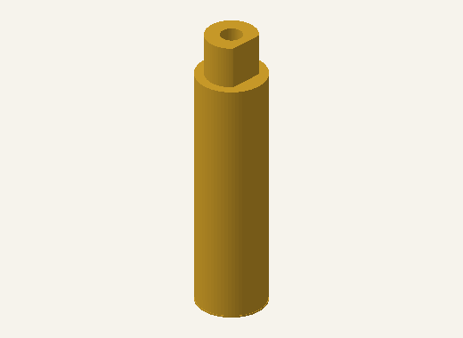

## Rodillo · 3 / Retener y regular

Colocar un mango R03 por extremo, dos aros W06 en ranuras externas, arandela R04 y chaveta H04 en la ranura final. Los aros abiertos llevan interferencia diametral nominal de 0,2 mm: no simula fuerza de encastre. Giro libre sin roce de mangos y sin salida del tambor. Ancho libre entre ranuras: 266 mm. Cubrir con barrera continua, sin pliegues bajo la masa.

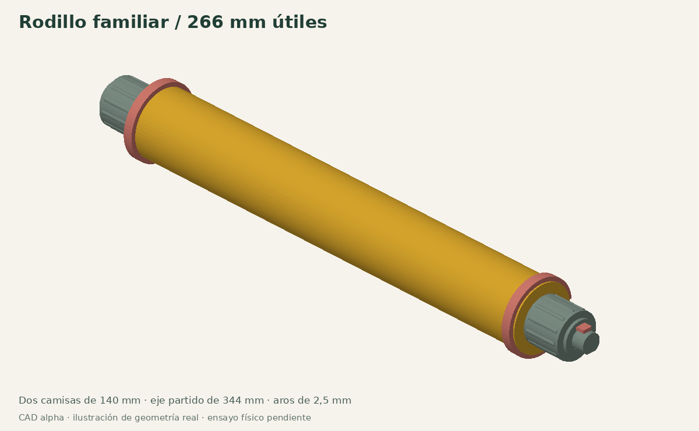

## Plegador · 1 / Colocar base y alas

Apoyar F01 centrado en el adaptador K04: x=5…195, y=50…150. Presentar ala norte H02N y sur H02S en sus bisagras. Los brazos de indexado quedan del mismo lado derecho. No intercambiar las dos alas. Dejar libre el recorrido fuera del Dock.

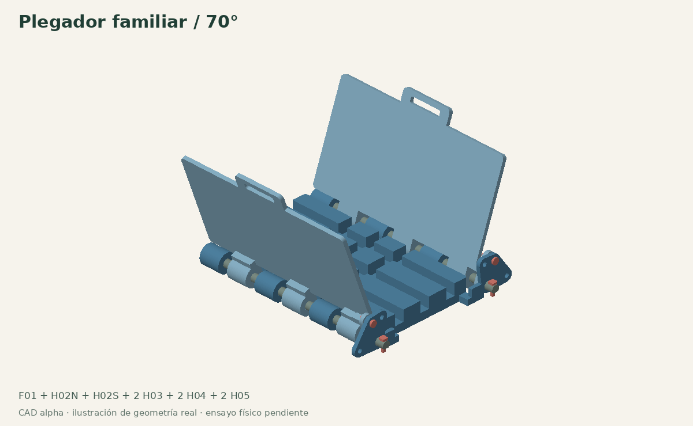

## Plegador · 2 / Retener e indexar

Introducir dos H03 desde el lado de las cabezas. Retener con una H04 por extremo. Insertar H05 en cada posición indexada: 0°, 70° o 100°. Para mover: sacar ambos H05, acompañar las alas a mano, volver a insertar. No usar los pasadores como palancas ni prensar la hallaca contra las alas.

## Ingredientes · 1 / Vasos y medidas

K06 recibe las medidas de guiso 40/60 ml; orientar ambos mangos hacia atrás, paralelos, hacia y=200. K07 aloja seis vasos individuales. Forrar cada recipiente destinado a alimentos con una barrera íntegra adecuada. El forro reduce volumen útil; pesar repeticiones si se busca dosificación consistente. Tapas son antipolvo, no herméticas ni para conservar comida.

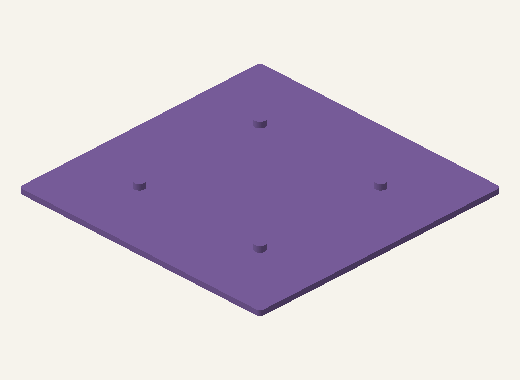

## Volcador · 1 / Fijar los soportes

K08: pies I02 en x=48/144 y y=140…196, contra topes laterales y delanteros. Dos I04 abrazan desde atrás el pie y la placa; la abertura mira hacia el frente y la pared cerrada queda detrás del borde de 200 mm. Las guías ubican, las abrazaderas retienen. Probar sin vaso, sin carga y sin levantar el conjunto por los brazos.

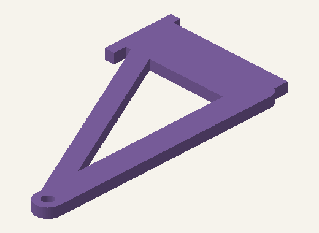

## Volcador · 2 / Eje fuera de la comida

Presentar las orejas de I01 entre soportes e introducir I03 desde la izquierda; retener con H04. El eje queda detrás del vaso, fuera de su cavidad, para no atravesar el forro ni la comida. Verificar giro libre en todo el recorrido antes de colocar forro. No hay resorte: volver a posición de carga con la mano.

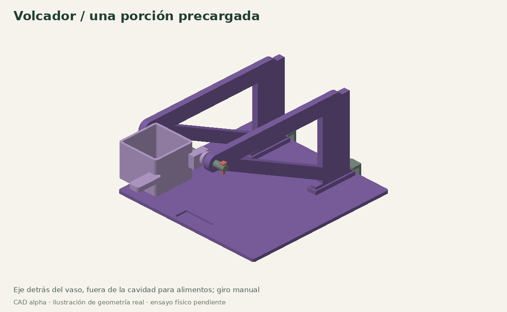

## Volcador · 3 / Cargar y volcar

Fijar el forro con pinzas I05 solo si ajustan sin soltarse ni obstruir el giro. Contar/cargar una porción; posicionar la hoja delante y sostener la base. Girar lentamente, recoger lo servido y volver. No inclinar varios niveles apilados ni intentar dosificar desde un depósito lleno. Los giros de 0/45/90/135° son muestras digitales, no ensayos de servicio.

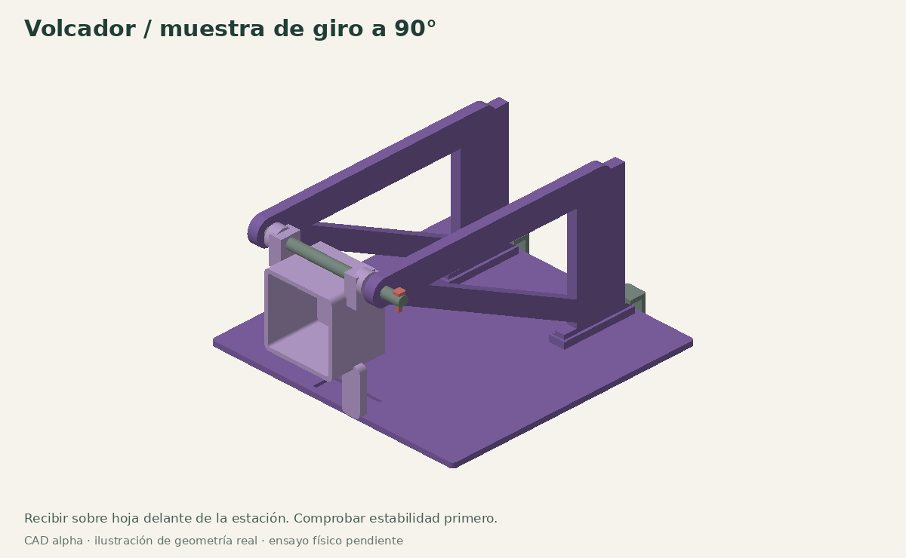

## Pabilo · 1 / Base independiente o compartida

En mesa única usar los canales de F01. En equipo poner F02 sobre K05, centrado en y=35…165. Pasar aguja roma por canales libres, sin atravesar la hoja. Anudar a mano. La base y el medidor no traen cuchilla.

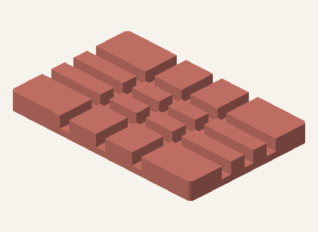

## Guardado · 1 / Desmontar y apilar

Sacar alimentos y barreras usadas, limpiar, secar, retirar las alas del plegador y todas las piezas que sobresalen. Insertar cuatro K09 en alojamientos de esquina de la baldosa inferior, después presentar arriba otra baldosa. Comprobar los cuatro encastres. Si el módulo toca el piso superior, desmontarlo: no aumentar la altura con postes encadenados.

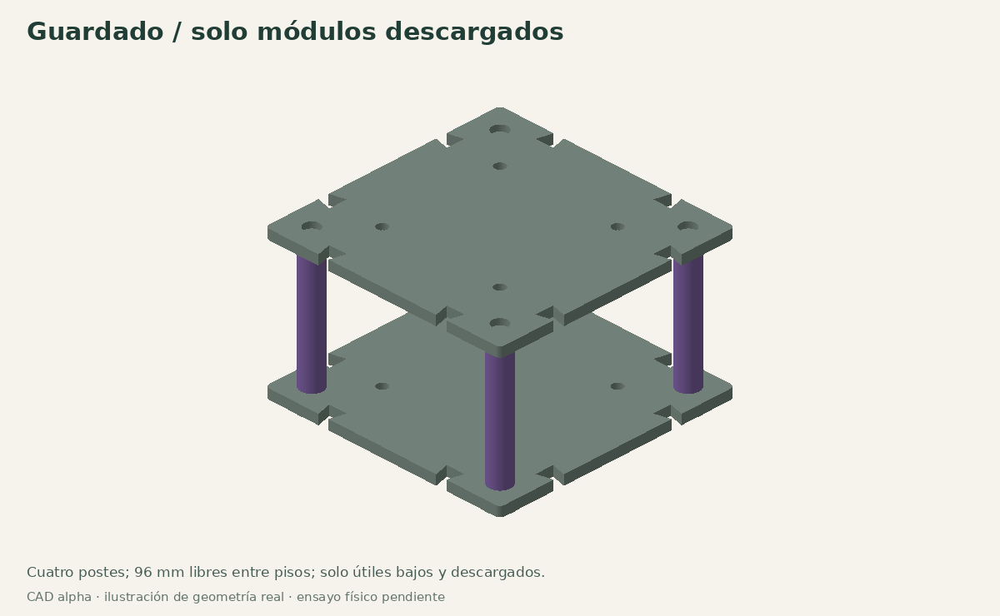
