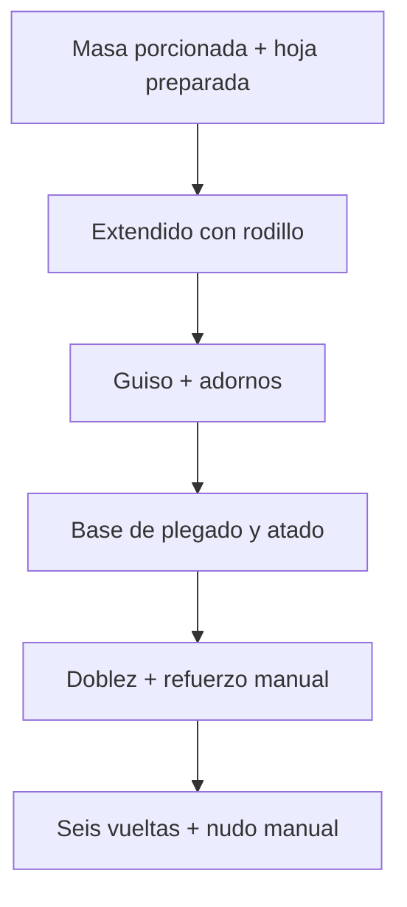

> Archivo técnico Compact 0.2. Para Familiar 0.3 ver el [manual actual](https://hallacaitor-manual.rajmaliuk.chatgpt.site).

# Diseño y decisiones - v0.2.0

[Inicio](../README.md) · [Montaje](assembly.md) · [Ensayos](testing.md)

## Requisitos y alcance

- Ayudar a una persona a armar hallacas con tamaños repetibles.
- Toda pieza permanente se fabrica por FDM: pasadores, llaves, ejes, mangos y uniones incluidos.
- Sin alimentación eléctrica, metal, adhesivos ni mecanismos cerrados difíciles de desarmar.
- Barreras alimentarias, hojas, cuerda y comida son consumibles; no cuentan como piezas impresas.
- El proceso térmico, lavado/ablandado y recorte de hojas quedan fuera. La dosificación, el doblez central y el nudo son manuales.
- No se promete velocidad, productividad industrial, carga máxima ni aptitud alimentaria certificada.

## Arquitectura

El tamaño de paquete de referencia es **140 × 80 × 35 mm**, centrado en **x=91 mm, y=0** de la base. Es un punto de partida geométrico; la receta real manda. No debe tratarse como una cavidad que obliga a comprimir la hallaca hasta esas medidas.

| Elemento | Valor inicial | Motivo |
|---|---:|---|
| Soporte central | 190 × 80 × 20 mm, esquinas redondeadas | Apoyo y canales de atado accesibles |
| Ejes de alas | y=±54 mm, z=10 mm | Separación para recorrer hasta 100° sin invadir el apoyo en las muestras comprobadas |
| Ejes de bisagra | Ø8 mm, una cara plana | Pieza horizontal, desmontable y retenida por chaveta |
| Agujeros de giro | Ø8,5 mm | Holgura diametral inicial 0,5 mm, se calibra |
| Nudillos | 22 mm de largo, huecos de 10 mm | Los huecos permiten entrar con aguja de 6 mm |
| Pasos transversales | x=59 / 91 / 123 mm | Coinciden con huecos axiales de las bisagras |
| Pasos longitudinales | y=-25 / 0 / 25 mm | Tres líneas dentro del paquete objetivo |
| Canales | 10 mm de ancho, 12 mm de profundidad | Deja espacio geométrico a aguja y cruces de cuerda |
| Índice de alas | 0°, 70°, 100° | Preparación, toma de hoja y posición final asistida |
| Rodillo | Ø40 mm, 200 mm de cuerpo | Mayor ancho útil que en v0.1 |
| Rodillo útil | 186 mm entre ranuras interiores | Evita que el disco invada los aros |
| Eje de rodillo | Ø12 mm con plano, 264 mm de largo | Dos mangos, cuerpo y retención en un solo eje; se imprime diagonal |
| Ranuras de aros | 6 mm de ancho, Ø39,4 mm | Asiento axial que reduce el desplazamiento del aro |
| Aro abierto | 5,6 mm de ancho, Ø39,2 mm interior | 0,2 mm de interferencia diametral de partida |
| Tabla | 4 baldosas de 180 × 180 × 6 mm | 360 × 360 mm, apoyada directamente en la mesa |
| Llaves de tabla | Perfil mariposa pasante, 5,8 mm alto | Unión en el plano, desmontable; sin pies ni conectores ocultos |

Los pines de posición **no son topes automáticos**: hay que quitarlos para mover el ala y volverlos a colocar. No se verificó el movimiento por encima de 100°. El nudo requiere dos manos; las alas se pueden fijar arriba o dejar abiertas, siempre que no estorben.

## Porción y espesor

Para una cavidad cilíndrica de diámetro d y volumen V:

`h = 4000 × V / (π × d²)` con V en ml y d/h en mm.

Para un disco ideal de espesor t:

`D = sqrt(4000 × V / (π × t))`.

| Volumen | Diámetro interior | Altura útil |
|---:|---:|---:|
| Masa 60 ml | 60 mm | 21,22 mm |
| Masa 80 ml | 60 mm | 28,29 mm |
| Masa 100 ml | 60 mm | 35,37 mm |
| Guiso 40 ml | 50 mm | 20,37 mm |
| Guiso 60 ml | 50 mm | 30,56 mm |

No hay una equivalencia fija ml → g. El forro reduce la capacidad útil y las arrugas dificultan enrasar. No se ha medido la repetibilidad de porciones. Para estudiar pérdidas, pesar varias porciones con una balanza externa y registrar la dispersión; la balanza no forma parte de la máquina.

## Hoja y plegado

La hoja inicial de **350 × 350 mm** es una hipótesis para este paquete. Puede necesitar más margen o refuerzo según roturas y rigidez. Se incorpora una plantilla a escala real que solo ayuda a medir; no sustituye el recorte ni el tratamiento previo de la hoja.

Las alas levantan material: **no forman por sí solas la costura**. Tomar los bordes, juntarlos, doblarlos y acomodarlos es trabajo manual. No se debe forzar una hoja pegada al ala ni tirar contra un pasador. Si la hoja no alcanza para cerrar y doblar, aumentar su tamaño o reducir la carga.

## Longitud de pabilo

Aproximación para tres vueltas por cada eje de un prisma:

`L = n × 2 × (l+h) + n × 2 × (w+h) + reserva`.

Para 140 × 80 × 35 mm, n=3 y reserva=300 mm: **2.040 mm**. Las conexiones entre vueltas, diagonales y el espesor de hoja no están modelados. Empezar el ensayo con **2,2 m** y ajustar desde una cuerda sobrante medida. El medidor tiene centros separados 180 mm y postes Ø12: una vuelta ideal es **397,7 mm**. Cinco vueltas ≈1.989 mm; para 2,2 m agregar aproximadamente 211 mm con la regla. No trae cuchilla.

## Cargas, desgaste y límites

No se hizo FEA ni ensayo de resistencia. Los pasadores mantienen posiciones, no están dimensionados para soportar el peso de una persona ni para prensar con palanca. Los aros y ejes se calibran; un material frágil o un ajuste forzado puede romperlos. Las chavetas son retirables y no tienen un seguro elástico validado: comprobar que siguen insertadas antes de cada tanda.

La base no incluye mordaza ni goma antideslizante porque todo su hardware es imprimible. Debe mantenerse estable sobre una mesa firme y sujetarse a mano cuando haga falta. Si se mueve durante el uso, parar y registrar la condición; no compensar apretando más fuerte.
