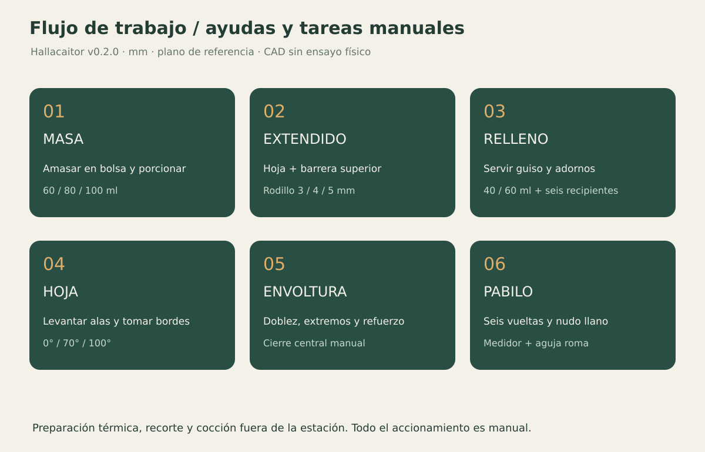
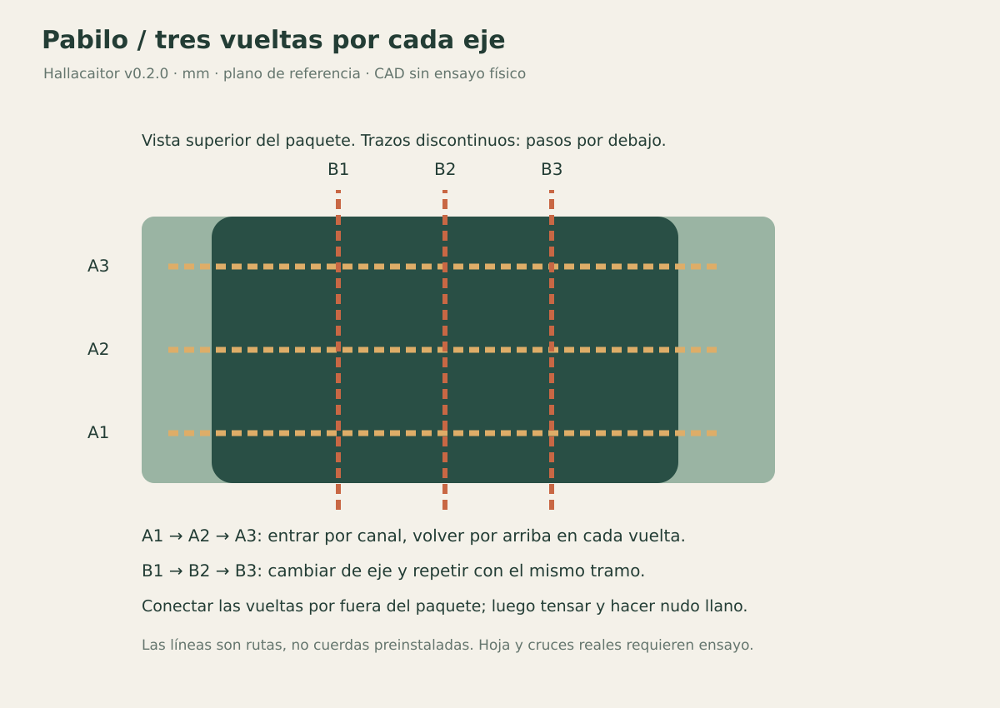

> Archivo técnico Compact 0.2. Para Familiar 0.3 ver el [manual actual](https://hallacaitor-manual.rajmaliuk.chatgpt.site).

# Del ingrediente al paquete

[Inicio](../README.md) · [Contacto alimentario](food-contact.md)

## Antes de empezar

Preparar el guiso y la masa con la receta elegida. Tener hojas limpias, flexibles, sin nervios gruesos en la zona de cierre y previamente recortadas; fajas/refuerzos y tramos de pabilo listos. Hallacaitor no cocina, lava, ahúma ni corta. La configuración inicial usa 80 ml de masa, aros de 4 mm y una hoja de unos 350 mm: todo requiere ajuste a tu receta.

Organizar la mesa en el orden de uso. Trabajar con tandas pequeñas de relleno; no dejar toda la preparación expuesta durante una sesión larga. La [guía alimentaria](food-contact.md) explica el alcance de las barreras.

## Masa

El amasado es manual dentro de una bolsa resistente apta para alimentos, apoyada en M01 o en la mesa. Cerrar según instrucciones de la bolsa y evitar cargar el cierre. Una bolsa abierta que deja entrar una pala impresa no mantiene la barrera. Si el volumen de masa no se puede manejar sin forzar la bolsa, dividir la tanda.

Colocar el aro D01 sobre una barrera, cubrir su interior y enrasar. Levantar el aro y ayudar con D02 también cubierto si hace falta. El número del aro es volumen geométrico antes de forrar, no peso. Evitar que el forro se arrastre hacia el alimento o quede atrapado entre aro y empujador.

## Hoja y extendido

1. Colocar la hoja en la tabla y aceitar según la receta.
2. Presentar la porción centrada; cubrir por arriba con una barrera alimentaria adecuada.
3. Pasar el rodillo con dos aros iguales, apoyando los aros en la misma superficie de referencia. Si pasan sobre arrugas o fuera de la hoja mientras el centro pasa sobre ella, el espesor cambia.
4. Dar varias pasadas suaves. Los aros limitan la distancia geométrica, pero el espesor real necesita medirse.
5. Retirar la barrera superior antes de servir relleno.

No añadir presión cuando la masa ya no se expande: puede estar seca, elástica o pegada. Reajustar la masa por la receta, no por fuerza sobre el rodillo.

## Relleno y cierre

Servir guiso con G01 forrado y agregar los adornos deseados. No se cuentan automáticamente aceitunas, pasas o alcaparras. Dejar masa libre alrededor del relleno. Transferir la hoja completa al plegador con las alas abiertas y el relleno paralelo a los ejes.

Levantar un ala sosteniendo la hoja y fijarla a 70°; repetir del otro lado. Cuando corresponda, fijar a 100° y retirar los bordes de hoja de las alas para juntarlos **con las manos**. Las alas no necesitan tocarse. Hacer el doblez central y acomodarlo; si no alcanza la hoja, no estirar ni forzar. Bajar las alas, doblar los extremos con la pala por fuera y colocar refuerzo/faja. El diseño no sustituye la inspección de roturas o zonas descubiertas.

## Pabilo, paso a paso

1. Colocar el paquete en la misma base, aproximadamente centrado en x=91, y=0.
2. Tomar un tramo de cuerda de prueba de unos 2,2 m y dejar una cola de aproximadamente 15 cm para el nudo. Enhebrar el extremo largo en el ojo de T01.
3. Pasar la aguja por debajo a través del canal y=-25, regresar por arriba y continuar con y=0 y y=25. Mantener los retornos fuera del paquete para que cada vuelta lo rodee.
4. Cambiar de dirección sin cortar la cuerda: repetir por x=59,91,123. Son tres vueltas por eje con un solo tramo. Acomodar las conexiones diagonales para que no desplacen las líneas.
5. En cada cruce, conservar espacio debajo de la cuerda anterior. La comprobación CAD solo verificó la aguja contra plástico, **sin hoja ni cuerda real**. Si se traba, levantar y recolocar; no punzar la hoja ni empujar con fuerza.
6. Retirar la aguja, tensar de forma pareja sin marcar ni cortar la hoja y hacer a mano un nudo llano: dos medios nudos de sentido opuesto. La cuña opcional ayuda a sostener un cabo, no reemplaza el nudo.
7. Levantar la hallaca: las cuerdas salen por la parte superior abierta de los canales. Si una queda alrededor de una bisagra o de la base, desatar y rehacer el recorrido.

No se afirma que enhebrar seis veces sea más rápido que atar de forma tradicional. Cronometrar ambos métodos. Si el atado a mano gana, usar el medidor y conservar ese método; el plegador y el rodillo siguen siendo módulos independientes útiles para ensayar.

## Después

Cocinar y conservar por el procedimiento seguro correspondiente a la receta, fuera de la estación. Retirar consumibles y desmontar piezas para inspección y limpieza. Una tanda de prueba debe registrar roturas, pérdidas durante cocción, peso de porciones y tiempos; no basta con que el paquete luzca bien antes de cocinar.
