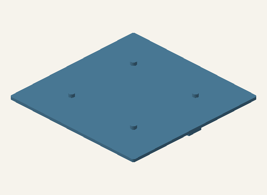

# Guía técnica de impresión y ajuste

[Manual web](https://hallacaitor-manual.rajmaliuk.chatgpt.site/printing.html) · [Inicio](../README.md)

Perfil inicial propuesto para FDM con boquilla de 0,4 mm; todavía no validado en una impresora. Los STL están en milímetros. El límite geométrico de cama es 220 × 220 × 250 mm; el brim también tiene que entrar.

## Material y perfil inicial

PETG como candidato para útiles mecánicos a temperatura ambiente; PLA sirve para maquetas de encastre, sin atribuir resistencia térmica o aptitud alimentaria. Capa 0,20 mm; 4 perímetros y 5 capas superior/inferior para placas y vasos; 5–6 perímetros y 40–60% de relleno para ejes, soportes y chavetas. Son ajustes de partida, no resultados de ensayo. Temperatura y ventilación según fabricante y calibración de tu filamento.

## Orden de impresión

Primero cupones. Después una unión de bisagra/eje/chaveta y una muestra de Dock. Luego F01 y dos alas para probar papel. Después el eje partido y acople del rodillo. Recién al final las ocho o nueve baldosas. Este orden evita gastar material en un sistema cuyo encastre todavía no se probó.

## Orientación por pieza

Cada ficha del catálogo muestra el STL en su orientación de exportación, dimensiones, soportes y cantidades. Ejes con plano D apoyado; no imprimir vertical por comodidad si cambia la resistencia. Camisas del rodillo en vertical: la derecha tiene la cavidad D hacia arriba. Los brazos del volcador van planos; su largo es 214 mm y permite brim de hasta 2 mm en cama de 220 mm.

## Adaptadores y soportes

Las tapas se exportan invertidas para imprimir los tetones hacia arriba. K04/K05 tienen topes de 3 mm y K08 de 5 mm que dejan parte de la placa elevada: requieren soportes bajo esa placa. Inspeccionar la vista previa y retirar soportes sin modificar los apoyos. Los adaptadores lisos y con alojamientos no necesitan ese soporte de placa. Orejas del plegador requieren soporte local según el laminador.

## Holguras que no son intercambiables

Bisagra/eje Ø8,5/8: 0,5 mm diametral. Dock Ø8,6/8: 0,6 mm diametral, entrada 4,4 en 5 mm. Postes Ø12,6/12: 0,6 mm. Camisas D: Ø30/29,4 y planos 11,6/11. Aros de rodillo: Ø39,2 interior sobre asiento Ø39,4: 0,2 mm de interferencia intencional, requiere elasticidad real. No aplicar un único porcentaje de escala a todo el conjunto.

## Cambiar tolerancia sin cambiar medidas

La opción --clearance del exportador ajusta únicamente los elementos del archivo Compact que usan ese parámetro; Dock y los acoples Familiar tienen cotas nominales explícitas en cad/modular.scad. Para cambiarlas hay que modificar pares macho/hembra en esa fuente y volver a exportar/verificar. No afirmar que --clearance recalibra toda la máquina.

## Aceptación antes del uso

Superficies sin filos, grietas, soportes ni partículas sueltas. Cuatro patas firmes, llaves al ras, adaptadores que asientan. Ejes entran sin golpes, chavetas quedan retenidas, alas giran sin rozar y aguja atraviesa canales sin atascarse. Rodillo no presenta escalón ni abertura en la unión; brazo volcador no flexiona ni vuelca con carga simulada. Registrar y corregir cualquier fallo antes de comida.

## Qué no incluyen las descargas

Sin G-code: depende de impresora, material y perfil. Sin tiempos de impresión ni gramos inventados: obtenerlos del laminador y registrarlos. Sin certificación alimentaria; el filamento y una superficie lisa por sí solos no garantizan un objeto higienizable.
