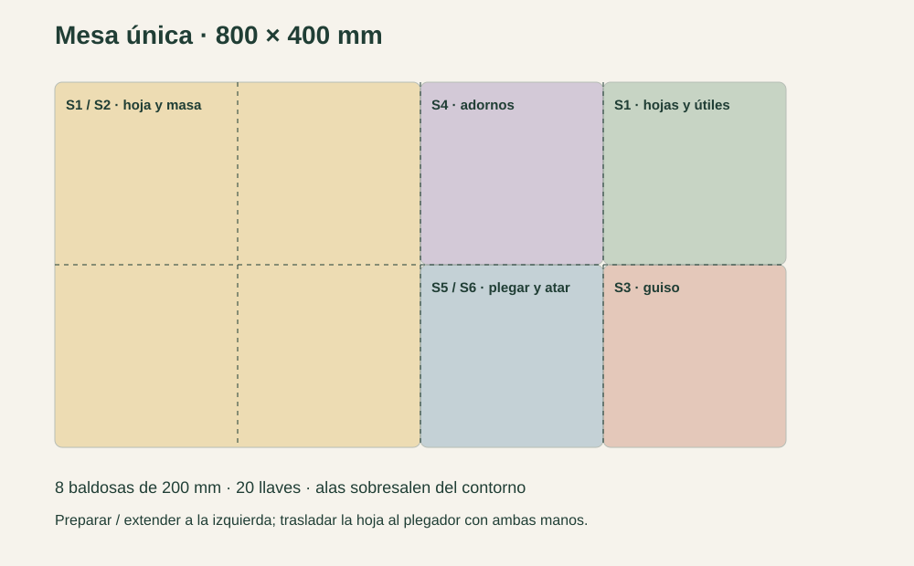
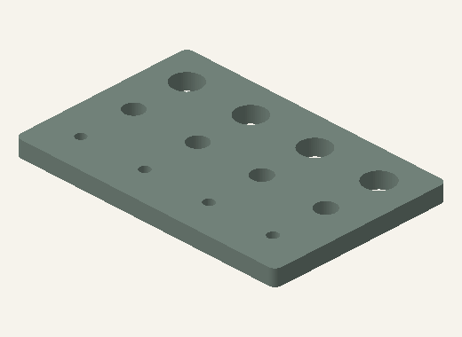
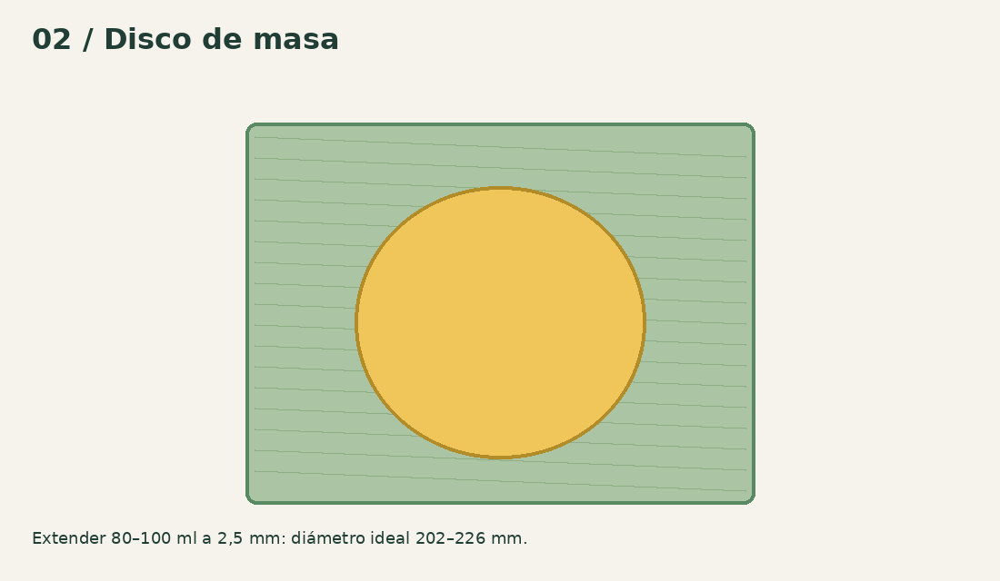

# Empezá con un módulo, después armá la mesa

[Manual web](https://hallacaitor-manual.rajmaliuk.chatgpt.site/start.html) · [Inicio](../README.md)

Hallacaitor es un sistema manual de útiles imprimibles. Esta versión 0.3 es un prototipo de CAD: todavía necesita impresiones y ensayos con hojas reales. No hace el guiso, cocina, recorta hojas ni anuda automáticamente.

## 1 · Elegí cómo trabajar

Mesa única: todos los útiles reunidos en una mesa de 800 × 400 mm, para una o dos personas. Estaciones repartidas: preparación de 400 × 400 mm y cinco módulos separados; se pueden repartir entre tres o seis personas. Duplicá el volcador si querés dedicar uno a cada ingrediente.

## 2 · No imprimas el kit entero todavía

Leé impresión y contacto alimentario. Imprimí fit_coupon y key_coupon, luego un par de bisagra y chaveta. Probá con la misma orientación, material y perfil que usarás en las piezas finales. Un encastre que requiere martillo no pasó la prueba.

## 3 · Probá el plegador Familiar

Usá F01, H02N y H02S, dos H03, dos H04 y dos H05. No imprimas dos alas del mismo lado. Seguí el montaje ilustrado; ensayá con papel y un paquete blando simulado. Guardá la aguja y los pasadores fuera del alcance de niños pequeños.

## 4 · Probá hoja y masa por separado

Primero hoja sin comida: comprobar que no se engancha en la bisagra. Después una prueba de masa con barreras alimentarias íntegras. Arrancá con 80 ml y 2,5 mm; el disco ideal tiene 202 mm. Ajustá a tu receta y medí el tamaño real, no conviertas ml a gramos sin medir densidad.

## 5 · Completá el sistema elegido

Solo después de resolver encastres, estabilidad y cierre de prueba, imprimí las baldosas, rodillo ancho y bandejas. El catálogo muestra cantidades por configuración. La torre se reserva para guardar módulos cerrados y descargados; no se opera apilada.

## 6 · Registrá qué pasó

Anotá impresora, material, perfil, hoja, volumen, espesor, fuerzas observadas y tiempo de diez ciclos. Un fallo de cierre o rotura importa tanto como el tiempo. El repositorio incluye una planilla vacía; no hay resultados físicos cargados.
