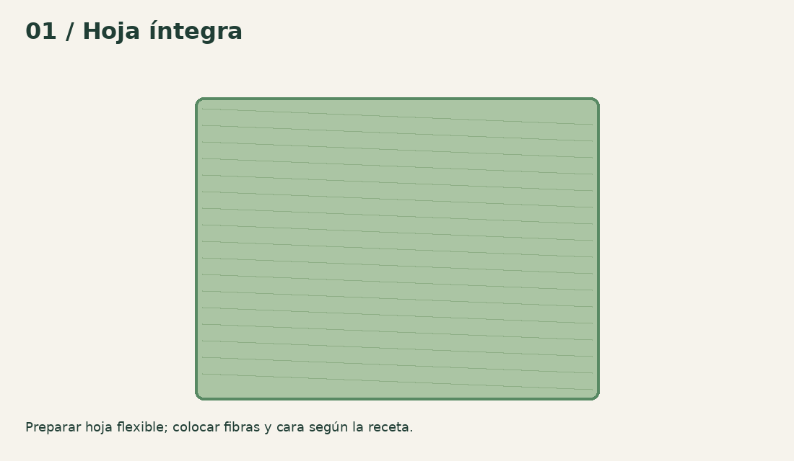
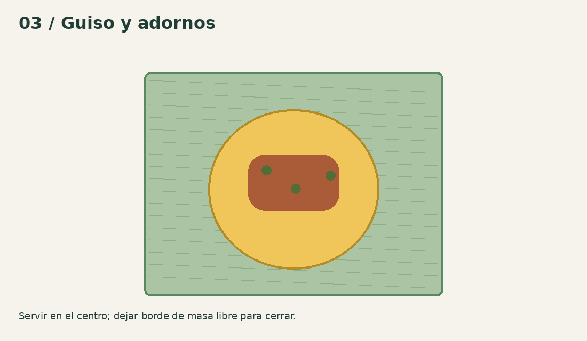
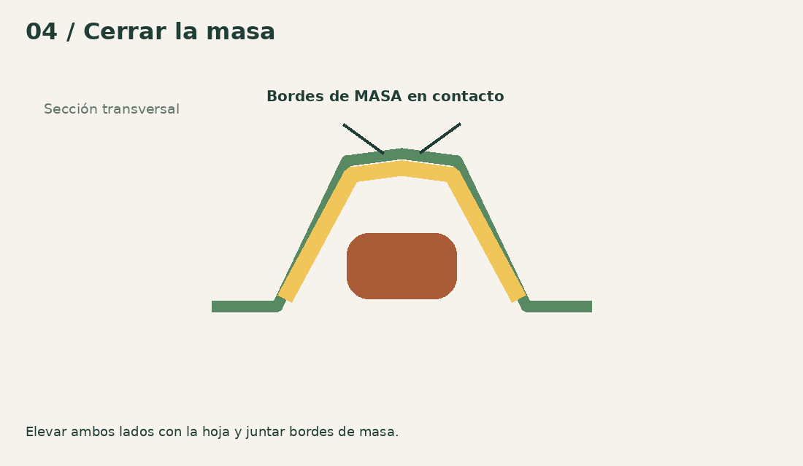
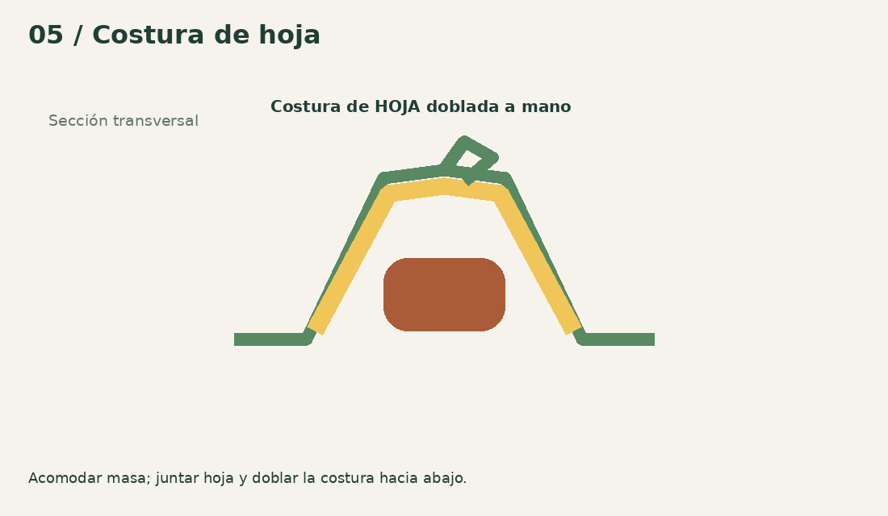
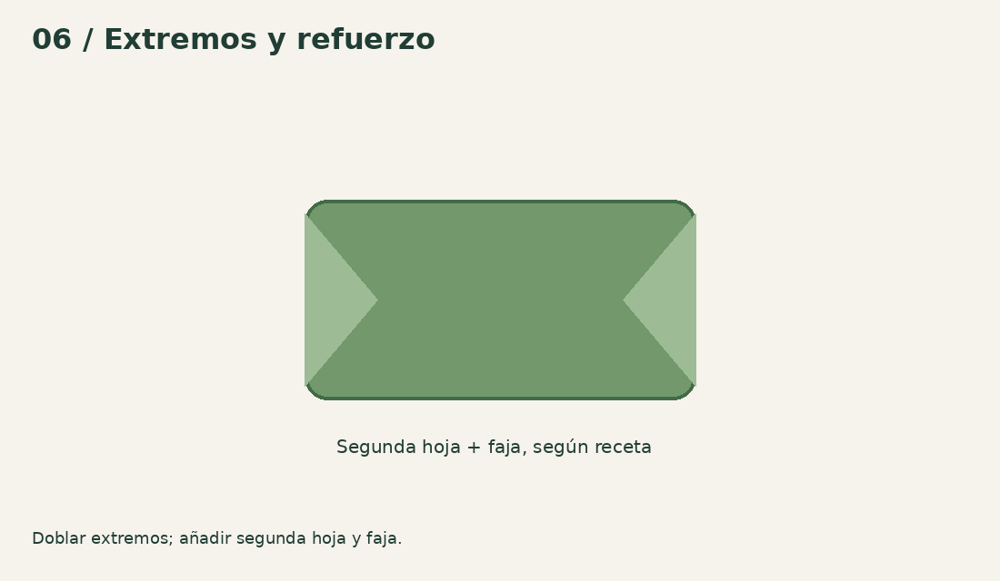
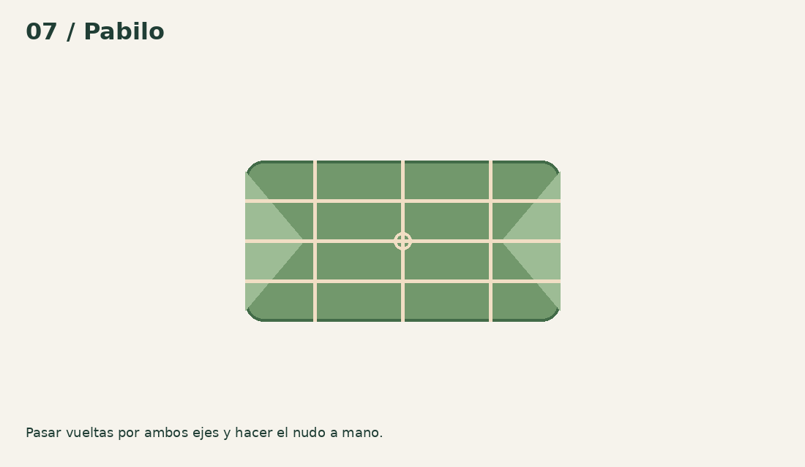

# De la hoja al pabilo, paso a paso

[Manual web](https://hallacaitor-manual.rajmaliuk.chatgpt.site/use.html) · [Inicio](../README.md)

La técnica de cierre depende de la receta familiar. El punto corregido respecto del boceto es unir la masa sobre el relleno antes de terminar la envoltura de hoja. Estos dibujos son esquemas propios, no fotos de una prueba realizada.

## 1 · Preparar la hoja

Lavar, ablandar y secar como indique la receta elegida. Revisar venas, cortes y roturas a contraluz. Preparar hoja principal, refuerzo y faja antes de servir comida. Para el primer ensayo Familiar usar hoja de 350–400 mm como hipótesis; comprobar que permite hacer la costura y doblar extremos. No hay un tamaño universal.

## 2 · Extender la masa

Colocar hoja aceitada según receta o barrera alimentaria íntegra sobre la superficie de 400 × 400. Forrar medida, llenar y enrasar. Empezar con 80 ml a 2,5 mm (202 mm ideales) o 100 ml (226 mm). Pasar el rodillo sin aplastar las juntas de las baldosas. Medir disco real; el cálculo supone espesor y densidad uniformes.

## 3 · Servir guiso y adornos

Mantener borde suficiente de masa libre alrededor del relleno. Medida abierta para guiso con trozos; reducir carga si impide cerrar. Aceitunas, pasas, alcaparras y tiras se cuentan o acomodan a mano. El volcador sirve la porción precargada, no selecciona ni corta ingredientes. Seguir tiempos y temperaturas de fuentes de seguridad alimentaria, no usar el montaje como conservación.

## 4 · Juntar la masa

Transferir la hoja cargada con ambas manos al plegador, centrada. Retirar pasadores. Elevar alas con suavidad y sostener la hoja para aproximar los bordes de masa. Unirlos sobre el guiso a mano, sin que quede hoja atrapada dentro de la masa. Las alas ayudan a levantar: no sellan automáticamente ni fuerzan el tamaño del paquete.

## 5 · Cerrar la hoja

Juntar los bordes largos de la hoja y hacer el doblez central según la receta. Doblar la costura sobre sí misma y acomodarla. Si la masa está abierta, corregir antes de cerrar la hoja. Si falta margen, abrir y reducir relleno o usar hoja mayor; no compensar tirando contra el pasador.

## 6 · Doblar extremos y reforzar

Bajar alas cuando estorben; acompañar los extremos con la pala, sin cortar la hoja. Plegar ambos extremos, envolver con hoja de refuerzo y colocar faja. La receta de referencia usa piezas de hoja de distintos tamaños; calibrar a las hojas disponibles. No calentar ni hervir el paquete con piezas impresas dentro.

## 7 · Atar

Colocar el paquete sobre los canales. Pasar pabilo en dos direcciones y anudar a mano sin desgarrar la hoja. Para paquete supuesto de 160 × 90 × 35 mm, tres vueltas por eje más 300 mm de reserva dan 2.220 mm geométricos; empezar la prueba con unos 2,4 m y medir sobrante. La receta puede usar menos vueltas. Cocción fuera de la estación.

